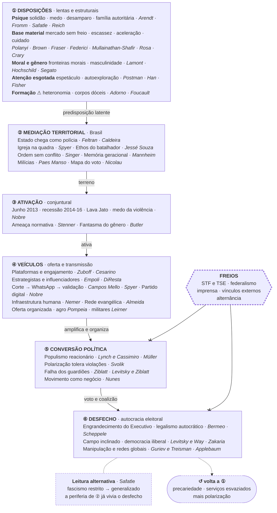
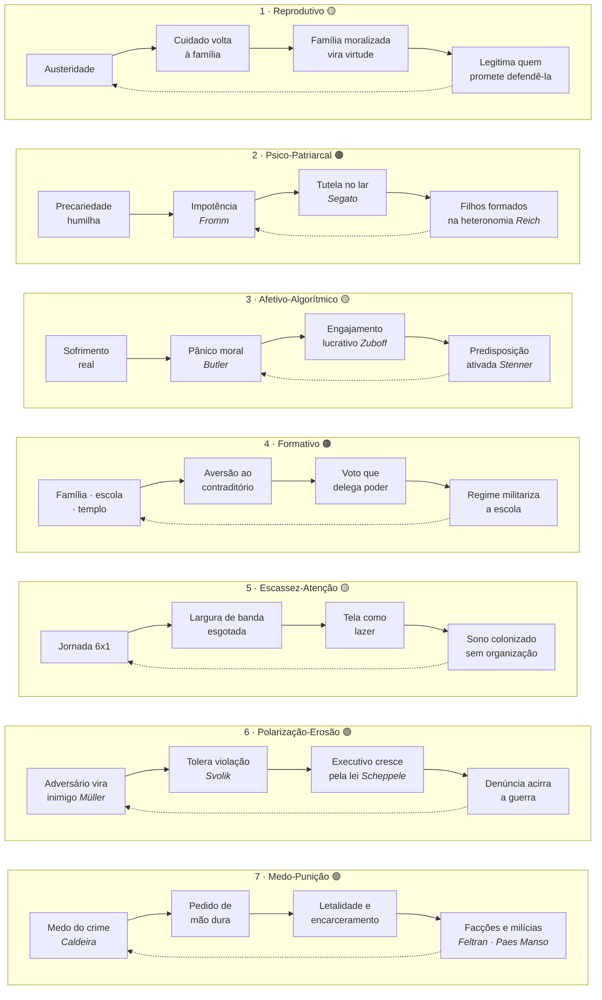

# Matriz Teórica

**Autocracia, Tecnologia e Exaustão Cognitiva — Dominação Psíquica, Material e Institucional**

*Out 2026 · Antonio Coelho · 73 fichas · dados eleitorais do 1º e do 2º turno de 2026 (coleta em 6 e 27 out 2026)*

> [!abstract] Tese central
> A autocracia do século XXI não chega por golpe: ela é **eleita por sociedades exaustas, isoladas e com medo**. Mas exaustão, isolamento e medo são **disposições**; sozinhas, não explicam *quando* a autocracia vence. Ela vence quando essas disposições são **ativadas** por uma conjuntura, **organizadas** por veículos (plataformas, igrejas-rede, partidos digitais, estrategistas) e **convertidas** em voto por uma oferta política que encontra os **freios** institucionais enfraquecidos.

> [!info] Distinção central
> Hannah Arendt reserva “totalitarismo” para regimes de controle total da vida (nazismo, stalinismo). A maioria dos casos atuais (Hungria, Turquia, Rússia) e o risco brasileiro são **autocracias eleitorais**: mantêm eleições e fachada democrática enquanto esvaziam as instituições. Por isso o fenômeno é tão difícil de reconhecer enquanto acontece.

## Sumário

- [[#1. Matriz por eixo|1. Matriz por eixo]] · as 57 entradas, em sete eixos
- [[#2. Arquitetura causal|2. Arquitetura causal]] · o esquema integrado, em diagrama e em camadas
- [[#3. Os sete circuitos de realimentação|3. Os sete circuitos de realimentação]] · como o sistema se reforça, com grau de robustez
- [[#4. Contrapontos e tensões|4. Contrapontos e tensões]] · o que relativiza o modelo
- [[#5. Aplicação ao Brasil · da mancha ao Congresso de 2027|5. Aplicação ao Brasil]] · fatos de 2005 a 2026 lidos pelos eixos
- [[#6. Lacunas e agenda|6. Lacunas e agenda]] · o que a matriz ainda não cobre
- [[#7. Trilha de leitura e glossário|7. Trilha de leitura e glossário]]

> [!tip] Como ler
> Cada eixo responde a uma pergunta e reúne entradas em formato de cartão: **tese** (o que o autor afirma) e **mecanismo** (como isso opera no sistema e se conecta a outros eixos). Os nomes das obras levam às fichas. A seção 2 junta tudo num diagrama; a seção 3 mostra os laços que fazem o sistema se reforçar; a seção 4 lista o que tensiona o modelo. Referências a seções usam **§** (ex.: §5.3), para não confundir com os IDs das fichas (ex.: 5.3 = Foucault).

### Mapa dos eixos

| Eixo | Pergunta | Autores | Fichas |
| --- | --- | --- | :---: |
| **1 · Raízes psíquicas** | Por que pessoas abrem mão da liberdade? | Fromm, Polanyi, Arendt, Safatle, Reich | 6 |
| **2 · Base material** | Como o desgaste do tempo, do corpo e do cuidado prepara o terreno? | Federici, Rosa, Crary, Mullainathan & Shafir, Brown, Fraser | 9 |
| **3 · Moral, gênero e religião** | Como o medo se torna combustível político? | Butler, Lamont, Stenner, Hochschild, Segato, Spyer, Mariano, Almeida, Biroli · Machado · Vaggione | 11 |
| **4 · Mente e tecnologia** | Como a infraestrutura digital captura atenção e corrói a verdade? | Postman, Fisher, Han, Zuboff, Empoli, Campos Mello, Cesarino, DiResta, Nemer, Mercier | 13 |
| **5 · Disciplina e formação** | Como instituições formam sujeitos obedientes ou autônomos? | Adorno, Foucault, Altemeyer, Castro, Frigotto, Freire | 8 |
| **6 · Brasil** | Que mediações nacionais explicam a virada autoritária? | Jessé Souza, Singer, Feltran, Pinheiro-Machado, Nobre, Lynch & Cassimiro, Caldeira, Mannheim, Nicolau, Paes Manso, Leirner, Pompeia, Nunes | 14 |
| **7 · Desfecho institucional** | Como a democracia morre por dentro? | Zakaria, Levitsky & Way, Bermeo, Müller, Levitsky & Ziblatt, Scheppele, Svolik, Guriev & Treisman, Applebaum, Ziblatt | 12 |

---

## 1. Matriz por eixo

### Eixo 1 · Raízes psíquicas e existenciais

> [!question] Por que pessoas abrem mão da liberdade?

> [!note] Hannah Arendt (1906–1975) · Solidão organizada e massa disponível
> **Obras.** [[1.3-arendt-origens-do-totalitarismo|Origens do Totalitarismo]] (1951); *A Condição Humana* (1958) · *filosófico / político*
>
> **Tese.** O totalitarismo não nasce de classes organizadas, mas de indivíduos desenraizados, isolados e supérfluos. A solidão (*loneliness*), perda de pertencimento a um mundo comum, produz a “massa” disponível para movimentos que prometem sentido e lugar.
>
> **Mecanismo.** Fundamenta o circuito de atomização: a destruição de sindicatos, associações e espaços públicos vem antes da adesão autoritária. Os casos atuais são autocracias eleitorais, que operam sobre a mesma solidão, mas sem terror de massa.
>
> **Tensão.** No Brasil a adesão não nasce do puro isolamento, mas de comunidades densas e fechadas (igreja, grupo de família). Ver Berman em [[#4. Contrapontos e tensões|§4]].

> [!note] Erich Fromm (1900–1980) · Fuga da liberdade e caráter autoritário
> **Obras.** [[1.1-fromm-o-medo-a-liberdade|O Medo à Liberdade]] (1941); *Ter ou Ser?* (1976) · *psicanalítico / social*
>
> **Tese.** A liberdade moderna libertou o indivíduo dos laços tradicionais, mas o deixou só, impotente e angustiado. Os mecanismos de fuga (submissão a uma autoridade, destrutividade e conformismo automático) aliviam essa angústia ao custo da autonomia.
>
> **Mecanismo.** Liga a angústia produzida pela precariedade ao desejo de um líder forte. Complementa [[1.6-reich-psicologia-de-massas-do-fascismo|Reich]] com uma leitura menos centrada na sexualidade e mais na estrutura social: quem se sente impotente terceiriza o próprio juízo à autoridade que promete ordem.

> [!note] Karl Polanyi (1886–1964) · Duplo movimento e mercado desincrustado
> **Obras.** [[1.2-polanyi-a-grande-transformacao|A Grande Transformação]] (1944) · *econômico / histórico*
>
> **Tese.** Quando o mercado se “desincrusta” da sociedade e transforma trabalho, terra e dinheiro em mercadorias fictícias, a vida social se desorganiza. A sociedade reage buscando proteção, e essa reação pode assumir forma democrática (*welfare*) ou autoritária (fascismo).
>
> **Mecanismo.** Ponte entre o neoliberalismo (Brown) e o desejo de ordem: a autocracia aparece como contramovimento protetor desviado. Explica por que a revolta contra a insegurança econômica nem sempre vai à esquerda; ela busca qualquer instância que restaure previsibilidade.

> [!note] Vladimir Safatle (1973–) · Circuito do medo e desamparo
> **Obras.** [[1.4-safatle-o-circuito-dos-afetos|O Circuito dos Afetos]]: corpos políticos, desamparo e o fim do indivíduo (2015) · *psicanalítico / político*
>
> **Tese.** Desde Hobbes, a política moderna se sustenta no medo: o Estado promete proteção (sobretudo da propriedade) e os sujeitos se ligam a ele por um circuito repetitivo de medo e esperança. Safatle propõe o desamparo (Freud) como outro afeto possível: assumir a insegurança como condição comum, em vez de entregá-la a uma autoridade.
>
> **Mecanismo.** Atualiza Fromm e Adorno para o Brasil contemporâneo e dá nome ao que a matriz descreve: medo da violência, pânico moral e ameaça normativa (Stenner) são o mesmo circuito, explorado por quem promete ordem. Liga o Eixo 1 ao Eixo 3 e aponta a saída que a matriz ainda não tem: um afeto político que não termine em submissão.

> [!note] Vladimir Safatle (1973–) · Fascismo restrito e fascismo generalizado
> **Obras.** [[1.5-safatle-a-ameaca-interna|A ameaça interna]]: psicanálise dos novos fascismos globais (2026) · *psicanalítico / político*
>
> **Tese.** O fascismo não é regressão, ressentimento nem patologia: nasce da própria concepção moderna de liberdade como propriedade de si. As ditas democracias liberais foram “fascismos restritos”, democráticas para certas zonas e grupos e violentas para outros; em crise, essas práticas se generalizam. Diante de uma dupla crise, econômica e psíquica, o fascismo oferece uma “militarização da subjetividade” e um Estado que deixa de proteger contra a morte (Estado suicidário).
>
> **Mecanismo.** Desloca a pergunta da matriz de “como a democracia morre” para “como o fascismo de sempre se espalha”: tensiona o Eixo 7 (Levitsky & Ziblatt) e reforça o Eixo 6 (Caldeira, Feltran: a periferia como zona descartável). Recusa patologizar o eleitor e lê o fascismo como resposta realista a sofrimentos que a esquerda no governo não resolveu.

> [!note] Wilhelm Reich (1897–1957) · Família autoritária e caráter de massa
> **Obras.** [[1.6-reich-psicologia-de-massas-do-fascismo|Psicologia de Massas do Fascismo]] (1933; ed. ampliada 1946) · *psicanalítico / político*
>
> **Tese.** O fascismo é a expressão política organizada do caráter do homem comum, formado pela família patriarcal e pela repressão sexual: submisso e revoltado ao mesmo tempo. Por isso as massas podem agir contra os próprios interesses, e o líder só vence quando encontra eco nessa estrutura.
>
> **Mecanismo.** Dá nome à família autoritária da camada ① e ao Circuito 2: a autoridade do pai prepara a obediência ao chefe, e o misticismo religioso oferece o alívio. **Limite:** a teoria sexual não se sustenta em dados, e o voto jovem de 2026, criado sob costumes mais livres, pende à direita (§5.3).

### Eixo 2 · Base material: tempo, corpo e cuidado

> [!question] Como o desgaste do tempo, do corpo e do cuidado prepara o terreno?

> [!note] Silvia Federici (1942–) · Acumulação primitiva e trabalho reprodutivo
> **Obras.** [[2.1-federici-caliba-e-a-bruxa|Calibã e a Bruxa]] (2004); [[2.3-federici-o-ponto-zero-da-revolucao|O Ponto Zero da Revolução]] (2012) · *material / patriarcal*
>
> **Tese.** O capitalismo depende estruturalmente da apropriação gratuita do trabalho doméstico e reprodutivo das mulheres: gerar, cuidar, alimentar e curar a força de trabalho sem remuneração.
>
> **Mecanismo.** O desmonte do bem-estar social empurra o custo da sobrevivência de volta ao lar. O machismo institucionalizado mascara essa superexploração como “dever natural de gênero”, convertendo déficit do Estado em virtude feminina.

> [!note] Nancy Fraser (1947–) · Capitalismo canibal e crise do cuidado
> **Obras.** [[2.9-fraser-capitalismo-canibal|Capitalismo Canibal]] (2022); *Fortunes of Feminism* (2013) · *material / crítica feminista*
>
> **Tese.** O capital consome as próprias condições de fundo das quais depende (cuidado, natureza, capacidade política e riqueza expropriada de populações racializadas) sem repô-las. A crise atual é simultaneamente econômica, ecológica, social e política.
>
> **Mecanismo.** Atualiza Federici como “crise do cuidado”: famílias exaustas não conseguem mais reproduzir a vida e, sem horizonte coletivo, aderem a promessas de restauração da família tradicional. Conecta a base material à crise de legitimidade política (Eixo 7).

> [!note] Wendy Brown (1955–) · Aliança neoliberal-neoconservadora
> **Obras.** [[2.8-brown-nas-ruinas-do-neoliberalismo|Nas Ruínas do Neoliberalismo]] (2019); [[2.6-brown-undoing-the-demos|Undoing the Demos]] (2015) · *político / teoconservador*
>
> **Tese.** O neoliberalismo é uma racionalidade que transforma o cidadão em capital humano e esvazia o *demos*. A desregulamentação dos mercados exige o fortalecimento da moralidade tradicional: restam só duas instâncias legítimas, o mercado e a família moralizada.
>
> **Mecanismo.** Produz um Estado mínimo na economia e autoritário na moral. A liberdade passa a significar liberdade de discriminar e de não ser regulado, terreno fértil para o populismo reacionário. No Brasil, o peso que Brown dá à masculinidade branca ferida pesa menos que religião e segurança pública.

> [!note] Sendhil Mullainathan & Eldar Shafir · Imposto da escassez sobre a largura de banda
> **Obras.** [[2.5-mullainathan-shafir-escassez|Escassez]]: uma nova forma de pensar a falta de recursos (2013) · *cognitivo / comportamental*
>
> **Tese.** A falta de dinheiro e de tempo captura a atenção e reduz a “largura de banda” cognitiva: planejamento, controle executivo e raciocínio fluido. Não é traço de caráter; é efeito da situação.
>
> **Mecanismo.** Dá base empírica à exaustão da escala 6x1 e da uberização: o trabalhador sobrecarregado tem menos recursos para pensar a longo prazo, deliberar ou checar informação. Base do circuito Escassez-Atenção. **Cuidado:** os estudos centrais tiveram replicação parcial (ver [[#4. Contrapontos e tensões|§4]]).

> [!note] Hartmut Rosa (1965–) · Aceleração social e perda de ressonância
> **Obras.** [[2.2-rosa-aceleracao|Aceleração]] (2005); [[2.7-rosa-ressonancia|Ressonância]] (2016) · *sociológico / temporal*
>
> **Tese.** A modernidade tardia acelera técnica, mudança social e ritmo de vida ao mesmo tempo. O sujeito corre para ficar no mesmo lugar e perde a relação “ressonante” (viva, responsiva) com o mundo, o trabalho e os outros.
>
> **Mecanismo.** Explica a falta de tempo para deliberar: a democracia exige tempo lento (debate, negociação, organização), e a aceleração o abole. A política vira reação instantânea, favorecendo líderes que oferecem decisões rápidas e simples.

> [!note] Jonathan Crary (1951–) · Colonização do sono e do tempo improdutivo
> **Obras.** [[2.4-crary-24-7|24/7]]: o capitalismo tardio e os fins do sono (2013) · *cultural / tecnológico*
>
> **Tese.** O capitalismo avança sobre a última fronteira não mercantilizada: o sono e o tempo de não fazer nada. A conexão permanente elimina pausas, devaneio e recuperação, mantendo o sujeito em disponibilidade contínua.
>
> **Mecanismo.** Conecta exaustão e conexão permanente: o tempo de tela residual depois da jornada não é descanso, é extensão do circuito produtivo. Prepara o terreno para a captura algorítmica descrita no Eixo 4.

### Eixo 3 · Moral, gênero e religião

> [!question] Como o medo se torna combustível político?

> [!note] Karen Stenner · Predisposição autoritária e ameaça normativa
> **Obras.** [[3.3-stenner-the-authoritarian-dynamic|The Authoritarian Dynamic]] (2005) · *psicologia política*
>
> **Tese.** A predisposição autoritária (preferência por unidade e conformidade sobre diversidade e autonomia) é estável, mas latente. Ela “acorda” diante de ameaça normativa: a percepção de que a ordem moral comum está se desfazendo.
>
> **Mecanismo.** É o modelo de interação que organiza a [[#2. Arquitetura causal|arquitetura causal]]: **predisposição × gatilho**. A mesma pessoa pode ser tolerante em tempos estáveis e intolerante sob ameaça percebida, o que explica por que choques morais mobilizam mais que argumentos econômicos.

> [!note] Judith Butler (1956–) · O fantasma do “anti-gênero”
> **Obras.** [[3.8-butler-quem-tem-medo-do-genero|Quem tem medo do gênero?]] (2024); [[3.1-butler-problemas-de-genero|Problemas de Gênero]] (1990) · *discursivo / teoconservador*
>
> **Tese.** A “ideologia de gênero” que movimentos reacionários dizem combater não existe como tal: é um **fantasma político**, uma figura que condensa angústias reais e difusas (precariedade, perda de status, insegurança) e as desloca para um inimigo único.
>
> **Mecanismo.** A incerteza econômica e o desamparo social são deslocados para o medo de destruição da infância e da ordem divina. É o gatilho de ameaça que Stenner descreve, funcionando como cola ideológica transnacional da extrema direita. **Cautela:** sem a escuta de Spyer, o conceito pode soar como diagnóstico de ilusão coletiva e reforçar o desprezo que alimenta a polarização.

> [!note] Rita Segato (1951–) · Mandato de masculinidade e pedagogia da crueldade
> **Obras.** [[3.5-segato-la-guerra-contra-las-mujeres|La guerra contra las mujeres]] (2016); [[3.6-segato-pedagogias-da-crueldade|Pedagogias da Crueldade]] (2018) · *antropológico / gênero*
>
> **Tese.** A violência contra as mulheres é a linguagem de uma forma de poder, a dos “donos”, que escreve no corpo feminino sua capacidade de controlar territórios. O mandato de masculinidade exige que o homem prove potência e, sem meios econômicos, ele o faz pela violência.
>
> **Mecanismo.** A masculinidade precarizada busca compensação no domínio sobre o corpo feminino. A insensibilidade treinada no machismo pavimenta a aceitação da violência estatal, policial e militar como solução legítima.

> [!note] Michèle Lamont (1957–) · Fronteiras morais e dignidade do trabalhador
> **Obras.** [[3.2-lamont-the-dignity-of-working-men|The Dignity of Working Men]] (2000) · *sociologia cultural*
>
> **Tese.** Trabalhadores constroem dignidade traçando “fronteiras morais”: definem-se como responsáveis, disciplinados e trabalhadores em oposição a quem está logo abaixo (o “vagabundo”, o beneficiário, o imigrante).
>
> **Mecanismo.** Explica o desdém pelo vizinho que recebe benefício social e a adesão ao discurso meritocrático. O ressentimento é dirigido para baixo e para o lado, não para cima, desviando a crítica da estrutura econômica.

> [!note] Juliano Spyer · Igreja evangélica como rede de proteção · contraponto
> **Obras.** [[3.7-spyer-povo-de-deus|Povo de Deus]] (2020) · *antropológico / religião*
>
> **Tese.** Para os pobres urbanos, a igreja evangélica é rede de proteção social, fonte de crédito, disciplina contra o álcool e a violência, e via de ascensão. A conversão tem razões materiais e afetivas compreensíveis.
>
> **Mecanismo.** Contraponto essencial: explica a adesão sem tratar o fiel como alienado. O templo ocupa o vácuo deixado pelo Estado e pelos sindicatos, por isso sua autoridade moral pesa na validação política (Eixo 6). **Limite:** o livro explica por que se entra na igreja, não como a liderança converte essa lealdade em máquina eleitoral.

> [!note] Arlie Russell Hochschild (1940–) · A “história profunda” · contraponto
> **Obras.** [[3.4-hochschild-strangers-in-their-own-land|Strangers in Their Own Land]] (2016) · *sociologia das emoções*
>
> **Tese.** Eleitores de direita compartilham uma narrativa sentida como verdadeira: esperam pacientemente na fila do sonho americano enquanto outros (minorias, imigrantes) “furam a fila” com ajuda do governo.
>
> **Mecanismo.** Contraponto metodológico: ouve o eleitor de direita em seus próprios termos. Mostra que a adesão é emocionalmente coerente, o que exige que qualquer resposta política dialogue com essa história, e não apenas a desminta.

> [!note] Ricardo Mariano · Neopentecostalismo e Teologia da Prosperidade
> **Obras.** [[3.9-mariano-neopentecostais|Neopentecostais]]: sociologia do novo pentecostalismo no Brasil (1999) · *sociologia da religião*
>
> **Tese.** As igrejas surgidas a partir dos anos 1970, com a Universal como modelo, romperam com o isolamento do pentecostalismo antigo: pregam prosperidade nesta vida, travam guerra contra o Diabo e as religiões afro-brasileiras e se acomodam à sociedade de consumo.
>
> **Mecanismo.** Fornece a gramática da Teologia da Prosperidade e o fim do lema “crente não se mete em política”, que abre caminho para a máquina eleitoral descrita por Almeida. Liga o Eixo 3 ao ethos do batalhador (Eixo 6). **Limite:** livro de 1999, anterior ao protagonismo político das igrejas clássicas.

> [!note] Ronaldo de Almeida · A onda conservadora quebrada
> **Obras.** [[3.10-almeida-bolsonaro-presidente|Bolsonaro presidente]]: conservadorismo, evangelismo e a crise brasileira (*Novos Estudos*, 2019) · *antropologia da religião*
>
> **Tese.** Parte expressiva dos evangélicos compõe a onda conservadora de 2018, feita de quatro linhas de força (liberal na economia, reguladora na moral, punitiva na segurança, intolerante nas relações). Em números absolutos, foram eles que fizeram a diferença, mas um terço votou em Haddad.
>
> **Mecanismo.** Resolve a lacuna de Spyer: mostra como a lealdade à igreja vira voto, não por ordem do pastor, mas porque os fiéis já tinham migrado. A eficácia do WhatsApp está na plausibilidade e na confiança em quem envia (Eixo 4).

> [!note] Flávia Biroli, Maria das Dores Campos Machado & Juan Marco Vaggione · Neoconservadorismo e juridificação reativa
> **Obras.** [[3.11-biroli-machado-vaggione-genero-neoconservadorismo-e-democracia|Gênero, neoconservadorismo e democracia]] (2020) · *ciência política / sociologia / direito*
>
> **Tese.** A cruzada antigênero na América Latina é um neoconservadorismo: une católicos, evangélicos e setores seculares, usa o direito para restaurar uma ordem moral centrada na família e redefine democracia como domínio da maioria cristã.
>
> **Mecanismo.** Mostra o pânico de Butler virando **lei** (aborto, escola, linguagem) e põe mulheres cristãs como agentes da agenda, primeira pista para o voto feminino à direita. Liga o Eixo 3 ao legalismo do Eixo 7 (Scheppele).

### Eixo 4 · Mente e tecnologia: atenção, dados e verdade

> [!question] Como a infraestrutura digital captura atenção e corrói a noção de verdade?

> [!info] Duas famílias neste eixo
> **Condição cognitiva** (Postman, Han, Fisher): descrevem um sujeito distraído, autoexplorado e sem futuro imaginável, e funcionam como *disposição*. **Infraestrutura e operadores** (Zuboff, Empoli, Campos Mello, Cesarino, DiResta): descrevem quem e o que transmite e organiza, e funcionam como *veículo*. A [[#2. Arquitetura causal|arquitetura causal]] separa as duas.

> [!note] Neil Postman (1931–2003) · Trivialização da esfera pública
> **Obras.** [[4.1-postman-amusing-ourselves-to-death|Amusing Ourselves to Death]] (1985) · *comunicação / produção de conhecimento*
>
> **Tese.** A transição do texto impresso para a imagem fragmentada destrói o debate racional e o transforma em espetáculo. Não é Orwell (proibição), é Huxley (distração): o que amamos nos arruína.
>
> **Mecanismo.** Antecipou o ecossistema móvel: a avalanche de estímulo superficial abole a capacidade analítica sem necessidade de censura formal. Precursor da crítica às plataformas.

> [!note] Mark Fisher (1968–2017) · Hedonia depressiva e cancelamento do futuro
> **Obras.** [[4.2-fisher-realismo-capitalista|Realismo Capitalista]] (2009); [[4.4-fisher-fantasmas-da-minha-vida|Fantasmas da Minha Vida]] (2014) · *cultural / ideológico*
>
> **Tese.** A impossibilidade de conceber alternativas ao capitalismo (“é mais fácil imaginar o fim do mundo”) e a compulsão por prazeres digitais de baixa voltagem: o sujeito incapaz de fazer outra coisa senão buscar estímulo.
>
> **Mecanismo.** Ajuda a ler a paralisia política sob a escala 6x1 e a uberização: a fadiga extrema veta o pensamento denso e canaliza o sujeito para o consumo dopaminérgico. Sem futuro imaginável, resta a nostalgia, que Brown mostra virar programa reacionário.

> [!note] Byung-Chul Han (1959–) · Psicopolítica e o empresário de si
> **Obras.** [[4.3-han-sociedade-do-cansaco|Sociedade do Cansaço]] (2010); [[4.5-han-psicopolitica|Psicopolítica]] (2014); [[4.9-han-infocracia|Infocracia]] (2021) · *psíquico / digital*
>
> **Tese.** O controle contemporâneo opera por sedução, transparência e autoexploração voluntária, não por proibição. O sujeito do desempenho explora a si mesmo acreditando ser livre; o “enxame digital” substitui a massa organizada.
>
> **Mecanismo.** O trabalhador se crê “empresário de si”, exaure-se nas redes, troca o debate pelo choque afetivo e perde a capacidade de solidariedade. Liga exaustão (Eixo 2) e atomização digital. **Tensão:** no Brasil, disciplina e violência direta seguem centrais para os mais pobres (Foucault, Caldeira); o poder “sorridente” de Han convive com o que diz “não”.

> [!note] Shoshana Zuboff (1951–) · Superávit comportamental
> **Obras.** [[4.6-zuboff-a-era-do-capitalismo-de-vigilancia|A Era do Capitalismo de Vigilância]] (2019) · *econômico / algorítmico*
>
> **Tese.** A experiência íntima é extraída de graça, convertida em dados e transformada em produtos preditivos de modificação de conduta, vendidos em mercados de comportamento futuro.
>
> **Mecanismo.** Explica o modelo de negócio que torna o engajamento extremado lucrativo: prever e induzir reações emocionais em massa. O *zero-rating* (WhatsApp e redes fora da franquia de dados) é prática comercial das operadoras, não tese de Zuboff, mas encaixa nessa economia ao fazer da rede social a internet inteira de quem tem plano pré-pago. **Contraponto:** Doctorow e Mercier contestam a eficácia da persuasão.

> [!note] Giuliano da Empoli (1973–) · A raiva como motor político
> **Obras.** [[4.7-empoli-os-engenheiros-do-caos|Os Engenheiros do Caos]] (2019) · *estratégia / comunicação*
>
> **Tese.** Estrategistas digitais (Bannon, Casaleggio, Cummings, entre outros) usam dados e algoritmos para identificar e amplificar as raivas de cada nicho, montando coalizões de ressentimentos contraditórios.
>
> **Mecanismo.** Liga plataformas a campanhas: o pânico moral não é só efeito colateral do engajamento, é matéria-prima deliberadamente cultivada. Mostra o lado profissional e planejado do caos aparente: o **lado da oferta**.

> [!note] Patrícia Campos Mello · Disparos em massa e ataques coordenados
> **Obras.** [[4.8-campos-mello-a-maquina-do-odio|A Máquina do Ódio]] (2020) · *jornalismo investigativo*
>
> **Tese.** Reportagem sobre disparos em massa no WhatsApp, financiamento empresarial oculto e campanhas coordenadas de assédio na eleição de 2018, incluindo os ataques que a própria autora sofreu. Em 2026, o padrão reaparece com disparos não declarados e áudios sintéticos.
>
> **Mecanismo.** Documenta a etapa de distribuição via mensageria no Brasil e a dimensão de intimidação a jornalistas, peça-chave do controle narrativo (Guriev & Treisman). Não mede o efeito sobre o voto.

> [!note] Letícia Cesarino · Lógica cibernética e inversão da verdade
> **Obras.** [[4.10-cesarino-o-mundo-do-avesso|O mundo do avesso]]: verdade e política na era digital (2022) · *antropologia digital*
>
> **Tese.** As redes produzem uma lógica cibernética de *feedback* contínuo que inverte as noções de verdade, autoridade e especialista. Instâncias tradicionais (ciência, imprensa) passam a ser suspeitas; o “avesso” vira referência.
>
> **Mecanismo.** É o caso brasileiro do Eixo 4: mostra o bolsonarismo digital como sistema auto-organizado, e não só como manipulação centralizada. Conecta-se ao circuito brasileiro de produção-distribuição-validação.

> [!note] Renée DiResta · Governantes invisíveis e confiança parassocial
> **Obras.** [[4.11-diresta-invisible-rulers|Invisible Rulers]]: The People Who Turn Lies into Reality (2024) · *comunicação / plataformas*
>
> **Tese.** A autoridade sobre o que é real migrou de instituições (imprensa, ciência) para influenciadores, que unem audiência fiel, algoritmo e multidões engajadas. O público confia neles como em alguém próximo, numa relação parassocial.
>
> **Mecanismo.** Troca a ideia de “suscetibilidade” por transferência de confiança: o jovem confia no influenciador como o fiel confia no pastor. Explica os recordes de Nikolas Ferreira e Lucas Pavanato em 2026 e o peso dos influenciadores na economia da aposta (§5.4).

> [!note] David Nemer · Tecnologia do oprimido e infraestrutura humana
> **Obras.** [[4.12-nemer-technology-of-the-oppressed|Technology of the Oppressed]] (2022) · *etnografia digital*
>
> **Tese.** Nas favelas de Vitória, a tecnologia é ao mesmo tempo opressão e ferramenta de sobrevivência. Em 2018, a desinformação no WhatsApp não dependeu de algoritmo: foi montada à mão por produtores de conteúdo, militantes que patrulhavam os grupos e participantes comuns.
>
> **Mecanismo.** É a primeira etnografia da etapa de **distribuição** do circuito brasileiro, a menos estudada. Também mostra o outro lado: o mesmo aplicativo organizou o Breque dos Apps em 2020.

> [!note] Hugo Mercier · Vigilância aberta · contraponto
> **Obras.** [[4.13-mercier-not-born-yesterday|Not Born Yesterday]] (2020) · *ciência cognitiva*
>
> **Tese.** As pessoas não são crédulas: avaliam conteúdo e mensageiro, e quase toda persuasão em massa fracassa ou só reforça o que o público já pensava. Notícias falsas circulam entre quem já concorda.
>
> **Mecanismo.** Contraponto central do Eixo 4: relativiza Zuboff e o Circuito 3 e explica por que o ataque da padroeira não colou em 2026 (§5.4). **Limite:** o 8 de Janeiro mostra crenças falsas virando ação cara.

> [!tip] Circuito brasileiro: produção → distribuição → validação
> No Brasil, o feed algorítmico pesa menos que a **mensageria**. O conteúdo percorre três etapas:
> - **Produção:** cortes rápidos e vídeos nascem no YouTube, TikTok e Instagram, otimizados para choque e compartilhamento (Empoli, Cesarino).
> - **Distribuição:** correntes e encaminhamentos levam esse conteúdo a grupos de WhatsApp de família, trabalho e igreja, favorecidos pelo *zero-rating* (Campos Mello).
> - **Validação:** a mensagem herda a confiança de quem enviou; o pastor e o influenciador funcionam como amplificadores de autoridade (Spyer, DiResta).
>
> O pânico moral entra **pelo grupo de quem a pessoa confia**, por isso resiste à checagem. Como o WhatsApp é criptografado, essa etapa é a menos estudada: uma lacuna empírica relevante do modelo.

### Eixo 5 · Disciplina e formação

> [!question] Como instituições formam sujeitos obedientes ou autônomos?

> [!note] Theodor W. Adorno (1903–1969) · Emancipação (*Mündigkeit*) vs. heteronomia
> **Obras.** [[5.2-adorno-educacao-apos-auschwitz|Educação após Auschwitz]] (1966); [[5.1-adorno-a-personalidade-autoritaria|A Personalidade Autoritária]] (1950) · *formativo / pedagógico*
>
> **Tese.** A educação deve vacinar contra a barbárie por meio da autonomia crítica e da recusa à submissão cega. Nota de método: a escala F (1950) foi superada empiricamente (viés de aquiescência, amostra) e retomada por Stenner; o ensaio de 1966 segue atual.
>
> **Mecanismo.** Ambientes educacionais pautados por ordem unida, punição e uniformização tendem a formar personalidades submissas à patente e agressivas com quem questiona. Base do circuito Formativo-Institucional.

> [!note] Michel Foucault (1926–1984) · Corpos dóceis e poder disciplinar
> **Obras.** [[5.3-foucault-vigiar-e-punir|Vigiar e Punir]] (1975); [[5.4-foucault-microfisica-do-poder|Microfísica do Poder]] (1979) · *disciplinar / corpos*
>
> **Tese.** O adestramento corporal em instituições de confinamento (escola, quartel, fábrica, prisão) visa extração máxima de utilidade e docilidade, por vigilância, exame e normalização.
>
> **Mecanismo.** Fundamenta a crítica à militarização escolar: o controle de cabelos, uniformes e posturas anula a singularidade e condiciona a obediência automática. **Tensão dupla:** Han declara o paradigma disciplinar superado; no Brasil, a violência policial letal se parece mais com o suplício que com a disciplina (Caldeira).

> [!note] Bob Altemeyer (1940–) · Autoritarismo de direita aprendido
> **Obras.** [[5.8-altemeyer-the-authoritarians|The Authoritarians]] (2006) · *psicologia social / empírico*
>
> **Tese.** Refaz a escala de Adorno sem os vícios de método: o autoritarismo de direita (submissão à autoridade, agressão autorizada contra desviantes, convencionalismo) é aprendido na socialização familiar e religiosa, não herdado como caráter.
>
> **Mecanismo.** Liga o Eixo 5 a Stenner (Eixo 3): a formação produz a predisposição que a ameaça ativa. **Limite:** pesquisa norte-americana; no Brasil, a medida segue sem estudo amplo.

> [!note] Celso Castro · A caserna como fábrica de identidade
> **Obras.** [[5.6-castro-o-espirito-militar|O espírito militar]] (1990) · *etnografia / Brasil*
>
> **Tese.** Etnografia da Academia Militar das Agulhas Negras: a formação do cadete constrói um “nós” militar superior e separado do “paisano”, pela rotina, pela hierarquia e pelo espírito de corpo.
>
> **Mecanismo.** Dá ao circuito Formativo-Institucional a primeira base brasileira e explica a matriz de valores que sai da caserna para a política. **Limite:** trata a formação de oficiais, não as escolas cívico-militares nem o 8 de Janeiro.

> [!note] Gaudêncio Frigotto e outros · A escola como campo de disputa
> **Obras.** [[5.7-frigotto-escola-sem-partido|Escola “sem” partido]] (2017) · *educação / Brasil*
>
> **Tese.** O movimento Escola sem Partido é um projeto político que se apresenta como neutro: pretende vigiar o professor, interditar gênero e política na sala de aula e reduzir a escola à instrução.
>
> **Mecanismo.** Mostra a formação como **projeto** do campo autoritário (o que o aviso abaixo já indica) e a liga ao pânico moral do Eixo 3 (Butler). **Limite:** coletânea militante; mede o projeto, não seu efeito sobre o aluno.

> [!note] Paulo Freire (1921–1997) · Educação bancária e conscientização · contraponto
> **Obras.** [[5.5-freire-pedagogia-do-oprimido|Pedagogia do Oprimido]] (1968) · *pedagógico / Brasil*
>
> **Tese.** A educação bancária deposita conteúdo num aluno passivo e reproduz a relação opressor-oprimido; a educação dialógica parte da experiência do oprimido e produz consciência crítica.
>
> **Mecanismo.** É o par brasileiro de Adorno (heteronomia × *Mündigkeit*) e explica a formação do sujeito que se mobiliza, como os estudantes que abrem os atos do 2º turno de 2026 (§5.5). **Limite:** obra normativa; não mostra quando a conscientização vira voto nem por que o oprimido adere ao opressor, ponto que o próprio Freire reconhece (o opressor “hospedado”).

> [!warning] Elo mais fraco da matriz
> O Eixo 5 tem a base brasileira mais recente da matriz (Castro, Frigotto, Freire) e nenhuma obra que meça o efeito da formação sobre o voto. O programa federal de escolas cívico-militares é de 2019 (encerrado em 2023; segue em programas estaduais), posterior à formação política de quem votou em 2018. A militarização escolar é, portanto, **efeito e projeto** do campo autoritário mais do que causa demonstrada. Trate o circuito Formativo-Institucional como hipótese (§3).

### Eixo 6 · Brasil: como chegamos aqui

> [!question] Que mediações nacionais explicam a virada autoritária brasileira?

> [!note] André Singer (1958–) · Subproletariado e desejo de ordem
> **Obras.** [[6.2-singer-os-sentidos-do-lulismo|Os Sentidos do Lulismo]] (2012) · *ciência política / Brasil*
>
> **Tese.** O subproletariado brasileiro quer melhora material, mas sem conflito nem desordem. A partir de 2006, o lulismo foi um “reformismo fraco” que entregou ganhos sem confrontação.
>
> **Mecanismo.** Explica a migração do voto popular quando a esquerda passou a ser associada a crise, recessão e desordem (2014–2016). A demanda por ordem, que antes sustentava o lulismo, foi capturada pela extrema direita.

> [!note] Jessé Souza (1960–) · Os batalhadores e o ethos do esforço
> **Obras.** [[6.1-jesse-souza-os-batalhadores-brasileiros|Os Batalhadores Brasileiros]] (2010); *A Ralé Brasileira* (2009) · *sociologia / classes*
>
> **Tese.** Uma fração de classe que subiu por esforço próprio (jornadas duplas, pequeno empreendedorismo, disciplina religiosa) não é “nova classe média”, mas nova classe trabalhadora precarizada; valoriza o mérito e se distancia simbolicamente de quem está abaixo (“a ralé”).
>
> **Mecanismo.** Base do ethos empreendedor e da rejeição à “dependência” de programas sociais. Dialoga com Lamont (fronteiras morais) e com a Teologia da Prosperidade: o sucesso é bênção, o fracasso é culpa individual.

> [!note] Jessé Souza (1960–) · Humilhação e falso moralismo
> **Obras.** [[6.9-jesse-souza-o-pobre-de-direita|O pobre de direita]]: a vingança dos bastardos (2024) · *sociologia / classes e raça*
>
> **Tese.** Nunca foi a economia: o pobre remediado (2 a 5 salários mínimos) vota na extrema direita em busca de reconhecimento e dignidade. Sem explicação para o próprio fracasso numa ordem meritocrática, dirige a raiva a quem está abaixo. O discurso da corrupção funciona como racismo “cultural”, e a oposição entre pobre honesto e pobre delinquente separa os que sofrem. No Sul e em São Paulo, o racismo se veste de preconceito regional; entre negros evangélicos, a igreja oferece apoio e uma moral que bloqueia a crítica social.
>
> **Mecanismo.** Explica como o ethos do batalhador vira voto: liga escassez (Eixo 2) a humilhação e ressentimento (Lamont, Hochschild) e dá base racial e regional à “fila do benefício” de 2026. Tensiona Spyer na leitura da igreja e Mullainathan & Shafir no peso da economia. **Limite:** explicação quase única e pouca agência do eleitor.

> [!note] Gabriel Feltran · Periferia entre igreja, crime e trabalho
> **Obras.** [[6.3-feltran-irmaos|Irmãos]]: uma história do PCC (2018); *Fronteiras de Tensão* (2011) · *etnografia urbana*
>
> **Tese.** O PCC funciona como sociedade secreta, uma “maçonaria do crime”, que produz ordem, justiça e regras de conduta em boa parte das periferias e prisões. Igreja, crime e trabalho disputam a mediação de conflitos no vácuo do Estado.
>
> **Mecanismo.** O Estado chega à periferia como polícia; a desconfiança nas instituições é aprendida pela experiência. Explica por que a promessa de “mais Estado” soa vazia e por que a ordem é interesse concreto, não abstração. Ligar o PCC ao voto é inferência desta matriz, não tese do livro.

> [!note] Marcos Nobre (1965–) · Pemedebismo, partido digital e colapso do sistema político
> **Obras.** [[6.5-nobre-limites-da-democracia|Limites da democracia]] (2022); *Imobilismo em Movimento* (2013) · *filosofia política / Brasil*
>
> **Tese.** A crise brasileira vem do esgotamento do pemedebismo (a blindagem do sistema por supercoalizões) exposto por Junho de 2013, e não apenas do eleitor. Bolsonaro chegou ao poder com um **“partido digital”** antissistema que levou o arranjo à sua forma-limite.
>
> **Mecanismo.** Insere a variável institucional: a autocracia avança quando o sistema partidário perde capacidade de representação. É o **gatilho** que quase todas as fichas apontam como ausente nas teorias de disposição.

> [!note] Christian Lynch & Paulo Cassimiro · Populismo reacionário brasileiro
> **Obras.** [[6.6-lynch-cassimiro-o-populismo-reacionario|O populismo reacionário]] (2022) · *história das ideias*
>
> **Tese.** O bolsonarismo é populismo reacionário, com raízes na tradição autoritária brasileira (militarismo, antiliberalismo, culto da ordem), nascido da crise de uma Nova República que apostou no Judiciário como motor do progresso.
>
> **Mecanismo.** Dá profundidade histórica ao modelo e mostra que o repertório autoritário estava disponível, aguardando condições de ativação. É a **oferta ideológica** que ocupa o vazio descrito por Nobre.

> [!note] Rosana Pinheiro-Machado · Agência popular e virada à direita · contraponto
> **Obras.** [[6.4-pinheiro-machado-amanha-vai-ser-maior|Amanhã vai ser maior]] (2019) · *antropologia / etnografia*
>
> **Tese.** A virada à direita não foi raio em céu azul nem obra de povo “alienado”: nasceu de revoltas ambíguas, desejos de inclusão que a esquerda não ouviu e um vazio de disputa que a direita ocupou primeiro (etnografia de juventudes de Porto Alegre).
>
> **Mecanismo.** Mostra a agência dos atores, não só a manipulação. Reforça os contrapontos (Spyer, Hochschild) e alerta contra explicações que reduzem o eleitor popular a vítima passiva de algoritmos.

> [!note] Karl Mannheim (1893–1947) · Gerações e socialização política
> **Obras.** [[6.8-mannheim-o-problema-das-geracoes|O Problema das Gerações]] (1928) · *sociologia do conhecimento*
>
> **Tese.** As experiências vividas no início da vida adulta (cerca de 17 a 25 anos) fixam a visão de mundo de uma geração. A mesma conjuntura produz leituras opostas conforme a memória de cada geração.
>
> **Mecanismo.** Explica a clivagem etária de 2026: quem tem de 16 a 34 anos formou-se politicamente entre 2013 e 2022 (Lava Jato, recessão, impeachment) e não viveu o crescimento dos anos Lula; quem tem 60 anos ou mais lembra de 2003–2010 e depende de aposentadoria. Jovens pendem a Flávio; idosos, a Lula (§5.3). Teoria geral, fica no Eixo 6 por esse uso.

> [!note] Teresa Caldeira (1954–) · A fala do crime
> **Obras.** [[6.7-caldeira-cidade-de-muros|Cidade de Muros]]: crime, segregação e cidadania em São Paulo (2000) · *antropologia urbana*
>
> **Tese.** O medo do crime organiza a cidade, a linguagem e a política: separa “cidadãos de bem” de “bandidos”, legitima muros, segurança privada e violência policial, e desacredita os direitos humanos.
>
> **Mecanismo.** Dá base teórica ao medo da violência e à força da “bancada da bala”. Liga a demanda por ordem (Singer, Feltran) à aceitação da violência estatal (Segato). Núcleo do novo circuito Medo-Punição (§3).

> [!note] Jairo Nicolau · Quem votou em Bolsonaro
> **Obras.** [[6.10-nicolau-o-brasil-dobrou-a-direita|O Brasil dobrou à direita]] (2020) · *ciência política / comportamento eleitoral*
>
> **Tese.** A vitória de 2018 foi a mais improvável da história eleitoral: sem dinheiro, tempo de TV ou palanques, Bolsonaro venceu nos três níveis de escolaridade, entre homens e evangélicos e nas grandes cidades fora do Nordeste. Em 2018, ser antipetista significou votar nele.
>
> **Mecanismo.** É o mapa empírico do voto que as teorias de disposição não dão. Mostra que, em 2018, a idade não dividia o eleitor, o que torna a clivagem geracional de 2026 um fato novo (Mannheim, §5.3).

> [!note] Bruno Paes Manso · A república das milícias
> **Obras.** [[6.11-paes-manso-a-republica-das-milicias|A República das Milícias]] (2020) · *jornalismo / segurança pública*
>
> **Tese.** No Rio, policiais e ex-policiais transformaram a proteção contra o tráfico num negócio armado sobre territórios, e a cultura do “bandido bom é bandido morto” subiu dos batalhões até a Presidência em 2018.
>
> **Mecanismo.** Completa o Circuito 7 pelo Rio: a mão dura não só pune, também gera poder armado ligado à política (caso Marielle). Complementa Feltran (PCC em São Paulo) e Caldeira.

> [!note] Piero Leirner · Militares e guerra híbrida
> **Obras.** [[6.12-leirner-o-brasil-no-espectro-de-uma-guerra-hibrida|O Brasil no espectro de uma guerra híbrida]] (2020) · *antropologia / etnografia militar*
>
> **Tese.** Um setor do Exército aplicou à política interna doutrinas de guerra híbrida e operações psicológicas, tratando a esquerda como inimigo interno; Bolsonaro funcionou como para-raios desse projeto, que operava melhor por ser quase invisível.
>
> **Mecanismo.** Põe os militares na **oferta** política e no desfecho (8 de Janeiro, condenação de generais em 2025). **Limite:** a recusa dos comandantes em dezembro de 2022 mostra que as Forças não agiram como bloco.

> [!note] Caio Pompeia · O agronegócio como ator político
> **Obras.** [[6.13-pompeia-formacao-politica-do-agronegocio|Formação política do agronegócio]] (2021) · *antropologia política*
>
> **Tese.** Agronegócio é uma categoria política construída desde os anos 1990, que fala em nome do mundo rural e negocia com o Estado uma posição privilegiada, mas é um campo heterogêneo, dividido entre exportadores sensíveis ao clima e produtores de extrema direita.
>
> **Mecanismo.** Preenche a lacuna da **oferta econômica**: a bancada ruralista e seu escritório privado-parlamentar (marco temporal, 2023), e a base que Bolsonaro construiu no interior antes das entidades nacionais.

> [!note] Rodrigo Nunes · Bolsonarismo como empreendedorismo
> **Obras.** [[6.14-nunes-do-transe-a-vertigem|Do transe à vertigem]]: ensaios sobre bolsonarismo e um mundo em transição (2022) · *filosofia política*
>
> **Tese.** O bolsonarismo é a resposta de extrema direita à crise aberta em 2008: uma política antissistema para quem não acredita que o sistema possa mudar, sustentada por negação coletiva, ressentimento e um empreendedorismo político em que a causa vira negócio.
>
> **Mecanismo.** Liga as disposições afetivas (Eixos 1 e 4) à **conversão** (⑤): militares, policiais, Centrão e influenciadores encontram no movimento oportunidade de ganho. Mostra a polarização como assimétrica, o que tensiona Svolik.

> [!tip] Territorialidade: Estado ausente, igreja presente
> O “batalhador conservador” (termo inspirado em Jessé Souza) é um **segmento** (evangélicos, periferias urbanas do Sudeste e Centro-Oeste, quem acabou de sair da pobreza), não a maioria dos pobres. Quatro forças se somam:
> - **Estado conhecido como polícia:** serviços falham; a promessa de “mais Estado” soa vazia (Feltran).
> - **Igreja na quadra:** oferece rede, cuidado e visão de mundo onde o Estado não chega (Spyer).
> - **Ethos do batalhador:** mérito e prosperidade como bênção; ressentimento contra quem “fura a fila” (Jessé Souza, Lamont, Hochschild).
> - **Medo da violência:** ordem é interesse concreto, não abstração (Singer, Feltran, Caldeira).
>
> A presença progressista nas periferias passava pelas **Comunidades Eclesiais de Base (CEBs)** católicas, que encolheram a partir dos anos 1990. As igrejas pentecostais ocuparam esse espaço. É esse terreno que torna eficaz o circuito do WhatsApp descrito no Eixo 4.

### Eixo 7 · Desfecho institucional

> [!question] Como a democracia morre por dentro?

> [!note] Fareed Zakaria (1964–) · Democracia iliberal
> **Obras.** [[7.1-zakaria-the-rise-of-illiberal-democracy|The Rise of Illiberal Democracy]] (1997); [[7.2-zakaria-o-futuro-da-liberdade|O Futuro da Liberdade]] (2003) · *político / teórico*
>
> **Tese.** Processo eleitoral majoritário e liberalismo constitucional são coisas diferentes: eleições livres não garantem liberdade.
>
> **Mecanismo.** O mandatário mobiliza o apoio popular e o discurso de salvação moral para anular a separação de poderes e as garantias individuais; o voto legitima a supressão de direitos. **Limite:** a defesa de instituições blindadas contra o voto carrega elitismo, num país onde as elites raramente cumpriram esse papel.

> [!note] Steven Levitsky & Lucan Way · Autoritarismo competitivo
> **Obras.** [[7.3-levitsky-way-competitive-authoritarianism|Competitive Authoritarianism]] (2010) · *política comparada*
>
> **Tese.** Há regimes com eleições disputadas de verdade em que o governo abusa do Estado para inclinar o campo de jogo. Seu destino depende dos **vínculos com o Ocidente** (*linkage*), da **vulnerabilidade a pressão externa** (*leverage*) e da força organizacional de partido e Estado.
>
> **Mecanismo.** Fornece o conceito de “campo inclinado” e uma variável que a matriz omitia: os freios externos (pressão internacional sobre o resultado de 2022). No Brasil, poder organizacional fraco foi compensado por rede digital forte.

> [!note] Nancy Bermeo · Engrandecimento do Executivo
> **Obras.** [[7.4-bermeo-on-democratic-backsliding|On Democratic Backsliding]] (*Journal of Democracy*, 2016) · *política comparada*
>
> **Tese.** O retrocesso democrático contemporâneo raramente é golpe clássico: é “engrandecimento do Executivo”, manipulação estratégica de eleições e golpes promissórios, por vias legais e graduais.
>
> **Mecanismo.** Descreve o ritmo lento e ambíguo que dificulta o reconhecimento do processo. Fundamenta a distinção central entre autocracia eleitoral e totalitarismo. O 8 de Janeiro mostra que o golpe à moda antiga não saiu do repertório.

> [!note] Jan-Werner Müller (1970–) · Populismo como antipluralismo
> **Obras.** [[7.5-muller-o-que-e-populismo|O que é populismo?]] (2016) · *teoria política*
>
> **Tese.** O populismo não se define pelo apelo ao povo, mas pela reivindicação moral de representação exclusiva: “só nós somos o povo”. Todo opositor é ilegítimo por definição.
>
> **Mecanismo.** Critério operacional para reconhecer o líder autocrata: a deslegitimação moral do adversário é o sinal precoce. Conecta o pânico moral (Eixo 3) à retórica política.

> [!note] Steven Levitsky & Daniel Ziblatt · Degradação interna e tirania da minoria
> **Obras.** [[7.6-levitsky-ziblatt-como-as-democracias-morrem|Como as Democracias Morrem]] (2018); [[7.10-levitsky-ziblatt-tirania-da-minoria|Tirania da Minoria]] (2023) · *político / institucional*
>
> **Tese.** Democracias morrem pelas mãos de eleitos que desmontam freios e contrapesos e corroem as normas informais de tolerância mútua e reserva institucional. Em 2023, os autores acrescentam um partido que, com medo de perder lugar, deixa de aceitar a derrota, e travas contramajoritárias que dão poder a essa minoria.
>
> **Mecanismo.** Regimes que preservam as urnas enquanto capturam a justiça, aparelham órgãos de inteligência e tratam adversários como inimigos existenciais. **Limite:** no Brasil, o risco contramajoritário pode ser o oposto do americano: um STF forte sob ataque e uma Constituição fácil de emendar.

> [!note] Daniel Ziblatt (1972–) · Partidos conservadores como guardiões
> **Obras.** [[7.12-ziblatt-conservative-parties-and-the-birth-of-democracy|Conservative Parties and the Birth of Democracy]] (2017) · *política comparada / histórica*
>
> **Tese.** A democracia sobrevive quando partidos conservadores fortes e organizados filtram os extremistas do próprio campo. Quando esses partidos enfraquecem, a extrema direita ocupa o espaço.
>
> **Mecanismo.** Explica o colapso do centro em 2026: o PSD cai de 14 para 5 senadores, o voto de Caiado migra para Flávio na última semana e o PL absorve a direita. É a falha dos guardiões (*gatekeeping*) em ato.

> [!note] Kim Lane Scheppele · Legalismo autocrático
> **Obras.** [[7.7-scheppele-autocratic-legalism|Autocratic Legalism]] (*University of Chicago Law Review*, 2018) · *jurídico / constitucional*
>
> **Tese.** Autocratas eleitos usam a própria lei (reformas constitucionais, mudanças em tribunais, regras eleitorais) para desmontar a democracia. Cada passo é formalmente legal; o conjunto é autoritário.
>
> **Mecanismo.** Explica a fachada de legalidade (Hungria de Orbán como caso paradigmático) e dá instrumental para identificar a captura institucional antes que ela se complete.

> [!note] Milan Svolik · Polarização e tolerância a violações
> **Obras.** [[7.8-svolik-polarization-versus-democracy|Polarization versus Democracy]] (*Journal of Democracy*, 2019) · *ciência política experimental*
>
> **Tese.** Experimentos mostram que eleitores polarizados aceitam violações democráticas cometidas pelo próprio lado quando votar contra significa entregar o poder ao lado que detestam.
>
> **Mecanismo.** Elo entre pânico moral e voto iliberal: quanto mais o adversário parece inimigo existencial, mais a democracia vira bem negociável. Base do circuito Polarização-Erosão.

> [!note] Sergei Guriev & Daniel Treisman · Ditaduras da manipulação (*spin*)
> **Obras.** [[7.9-guriev-treisman-spin-dictators|Spin Dictators]] (2022) · *estratégia / governança*
>
> **Tese.** O ditador típico do século XXI governa pela manipulação da informação, asfixia regulatória e simulação de normalidade civil, em vez da repressão aberta.
>
> **Mecanismo.** O poder não fuzila em praça pública: compra jornais via oligarcas aliados, altera discretamente regras eleitorais e mantém os shopping centers abertos. É a forma do regime no fim do processo. **Limite:** estuda regimes já instalados; não prevê a reação de STF e TSE.

> [!note] Anne Applebaum (1964–) · Redes cleptocráticas transnacionais
> **Obras.** [[7.11-applebaum-autocracia-sa|Autocracia S.A.]] (2024); *O Crepúsculo da Democracia* (2020) · *geopolítico / transnacional*
>
> **Tese.** As autocracias contemporâneas não se unem por ideologia, mas por interesses: formam redes de apoio financeiro, tecnológico, de vigilância e de propaganda que se protegem mutuamente.
>
> **Mecanismo.** Acrescenta a dimensão transnacional: a autocracia local se apoia em fluxos globais de dinheiro, tecnologia e desinformação, que ajudam a circular campanhas como o pânico “anti-gênero” (Butler). A rede global é **amplificador, não causa**: a ameaça brasileira veio de dentro.

---

## 2. Arquitetura causal

> [!info] Como o esquema se organiza
> Metade dos pontos de cautela das fichas diz, com outras palavras, *“explica a disposição, não o gatilho”*. Por isso o esquema segue a lógica de Stenner (**predisposição × ativação**), separa os **veículos** (oferta e transmissão) da condição cognitiva e inclui os **freios**, sem os quais a pergunta de controle (2022 × 2026) não tem resposta.

> [!example]+ ① Disposições · o que está presente antes de qualquer crise
> - **Solidão organizada (Arendt):** desenraizamento e perda do mundo comum; indivíduos supérfluos tornam-se “massa” disponível.
> - **Medo à liberdade (Fromm):** angústia da autonomia sem amparo; alívio pela submissão a uma autoridade.
> - **Família autoritária (Reich, Adorno):** heteronomia primária, obediência ao pai, repressão afetiva convertida em ódio ao diferente. Para Safatle, é a família *normal*, não um desvio.
> - **Circuito do medo (Safatle):** o Estado que promete proteção prende os sujeitos ao medo e à espera do salvador.
> - **Duplo movimento (Polanyi):** o mercado desorganiza a vida; a sociedade busca proteção, que pode tomar forma autoritária.
> - **Neoliberalismo precarizante (Brown):** uberização, escala 6x1, desmonte do *welfare*; Estado mínimo na economia, autoritário na moral.
> - **Trabalho reprodutivo gratuito (Federici, Fraser):** mulheres assumem creche, saúde e asilo; o capital consome suas condições.
> - **Escassez cognitiva (Mullainathan & Shafir):** falta de tempo e dinheiro reduz a largura de banda mental.
> - **Aceleração e 24/7 (Rosa, Crary):** sem tempo para deliberar; sono e pausa colonizados.
> - **Fronteiras morais e masculinidade (Lamont, Hochschild, Segato):** dignidade contra quem está abaixo; potência provada pela violência.
> - **Atenção esgotada (Postman, Han, Fisher):** espetáculo sem atrito, autoexploração com culpa individual, anestesia dopaminérgica no lugar do descanso.
> - **Formação heterônoma (Adorno, Foucault):** submissão à farda e à patente, desvio punido como quebra moral. ⚠ hipótese, ver Eixo 5.

> [!example]+ ② Mediação territorial brasileira · Estado ausente, igreja presente
> - **Estado conhecido como polícia (Feltran, Caldeira):** periferia organizada entre igreja, crime e trabalho; desconfiança aprendida; a “fala do crime” separa cidadão de bem e bandido.
> - **Igreja na quadra (Spyer):** rede de proteção, crédito e ascensão; pastor como autoridade moral; o templo ocupa o espaço das CEBs e do sindicato. Comunidade **densa**, não atomização.
> - **Ethos do batalhador (Jessé Souza, Lamont):** mérito e prosperidade como bênção; Teologia da Prosperidade como gramática (Spyer, Jessé Souza).
> - **Desejo de ordem sem conflito (Singer):** a demanda que sustentou o lulismo fica disponível quando a esquerda é associada a crise.
> - **Memória geracional (Mannheim):** quem se formou entre 2013 e 2022 não tem a memória dos anos de crescimento.
> - **Milícias (Paes Manso):** no Rio, a proteção contra o tráfico vira poder armado de policiais e ex-policiais, com elos na política.
> - **Igreja neopentecostal (Mariano):** prosperidade e guerra espiritual como gramática; o crente que antes fugia do mundo passa a negociar com ele.
> - **Mapa do voto (Nicolau):** em 2018, o bolsonarismo foi fenômeno urbano, masculino e evangélico, vencendo nos três níveis de escolaridade fora do Nordeste.

> [!example]+ ③ Ativação · o que acorda a disposição
> - **Gatilhos conjunturais:** Junho de 2013 e o esgotamento do pemedebismo (Nobre); recessão de 2014 a 2016 (Polanyi); Lava Jato e antipetismo como identidade; medo da violência urbana.
> - **Ameaça normativa (Stenner):** a percepção de que a ordem moral se desfaz ativa a predisposição latente.
> - **Crise de 2008 e negação (Nunes):** as promessas de prosperidade perdem credibilidade, mas não há alternativa; a negação coletiva cria demanda por mentiras confortáveis.
> - **Tradução da angústia material (Butler):** a insegurança econômica vira pânico de gênero e moral: ameaça à família, às crianças e à fé.
> - **Desvio da revolta:** a raiva contra a miséria econômica é redirecionada à caça aos “inimigos da ordem”, e o ressentimento vai para baixo, não para cima (Lamont).

> [!example]+ ④ Veículos · quem organiza e transmite
> - **Superávit comportamental (Zuboff):** plataformas monetizam o tempo de tela residual e impulsionam o choque moral porque engaja mais.
> - **Raiva como matéria-prima (Empoli):** estrategistas segmentam ressentimentos e montam coalizões contraditórias.
> - **Lógica cibernética (Cesarino):** inversão da verdade e da autoridade; o bolsonarismo como ecossistema auto-organizado.
> - **Confiança parassocial (DiResta):** o influenciador herda a confiança que era da imprensa e da ciência.
> - **Mensageria e *zero-rating* (Campos Mello):** produção no YouTube e TikTok → grupos de família e igreja → validação por confiança.
> - **Partido digital (Nobre):** veículo antissistema que dispensa a estrutura partidária clássica.
> - **Infraestrutura humana (Nemer):** nos grupos de WhatsApp, a bolha é montada por pessoas com papéis definidos, não por algoritmo.
> - **Rede evangélica (Almeida):** os fiéis migram antes dos líderes; a palavra do pastor chancela um voto já mobilizado.
> - **Oferta organizada (Pompeia, Leirner):** a bancada ruralista e seu escritório técnico; um setor militar que trata a esquerda como inimigo interno.

> [!example]+ ⑤ Conversão política · do afeto ao voto
> - **Populismo reacionário (Lynch & Cassimiro):** repertório autoritário histórico reativado como oferta ideológica.
> - **Antipluralismo (Müller):** “só nós somos o povo”; todo opositor é ilegítimo.
> - **Polarização (Svolik):** tolerância a violações do próprio lado; o antipetismo eleva o preço de votar contra.
> - **Falha dos guardiões (Ziblatt, Levitsky & Ziblatt):** o centro-direita se esvazia e deixa de filtrar extremistas.
> - **Movimento como negócio (Nunes):** militares, policiais, Centrão e influenciadores encontram no bolsonarismo oportunidade de ganho.
> - **Juridificação reativa (Biroli, Machado & Vaggione):** a pauta moral vira projeto de lei e disputa nos tribunais.
> - **Paralisia da resistência coletiva (Fisher, Han):** cancelamento do futuro e enxame sem projeto de classe.

> [!example]+ ⑥ Desfecho macropolítico · a autocracia eleitoral
> - **Democracia iliberal e autoritarismo competitivo (Zakaria, Levitsky & Way):** o líder forte é referendado nas urnas como salvador da Pátria e da Família; o campo de jogo é inclinado em nome da “maioria moral”.
> - **Engrandecimento do Executivo e legalismo autocrático (Bermeo, Scheppele):** cada passo é legal; o conjunto é autoritário, sem golpe visível.
> - **Ditadura da manipulação (Guriev & Treisman):** controle da imprensa por asfixia financeira e oligarcas amigos; fachada democrática e estabilidade de consumo mantidas (Huxley).
> - **Redes transnacionais (Applebaum):** dinheiro, tecnologia e propaganda circulando entre autocracias.

> [!danger] Leitura alternativa · fascismo generalizado (Safatle, 2026)
> Não é a democracia que morre: práticas antes restritas a zonas e grupos descartáveis (a periferia de Caldeira e Feltran) se generalizam. Estado suicidário: o Estado deixa de proteger contra a morte e naturaliza a catástrofe. No diagrama, ela aparece como nota pontilhada ao lado do desfecho.

> [!success] Freios
> STF e TSE (inelegibilidade em 2023, condenação em 2025), federalismo e governos estaduais de outros campos, imprensa profissional, vínculos e pressão externa sobre o resultado de 2022 (Levitsky & Way), alternância de 2022. Os freios não eliminam disposições nem veículos, mas explicam por que o mesmo ecossistema perde numa eleição e lidera noutra.

**↺ Ciclo de retorno.** O regime, ou a ameaça dele, aprofunda a precariedade, esvazia serviços públicos e polariza ainda mais, realimentando as disposições.

> [!quote] Síntese
> A submissão à autocracia é naturalizada: a sociedade já foi *educada na heteronomia doméstica, disciplinada na escola militar, exaurida pela escassez de tempo, dopada pelas redes móveis, validada pelo grupo de confiança e moralizada pelo púlpito teocrático*. O voto, então, não amplia a cidadania: delega poder a quem promete silenciar o dissenso. **Mas** isso só acontece quando um gatilho acorda essas disposições, um veículo as organiza e os freios cedem.

---

## 3. Os sete circuitos de realimentação

Cada circuito transforma a saída de um eixo na entrada de outro, fazendo o sistema se reforçar. No diagrama, cada linha é um laço (a seta pontilhada fecha o ciclo) e a cor indica a robustez: 🟢 forte, 🟡 plausível, 🟠 hipótese.

| # | Circuito | Autores | Robustez | Elo mais frágil |
| :---: | --- | --- | :---: | --- |
| 1 | Econômico-Reprodutivo | Federici · Fraser · Brown | 🟡 plausível | Passagem da sobrecarga ao voto não é medida |
| 2 | Psico-Patriarcal | Reich · Fromm · Segato | 🟠 hipótese | Teoria sexual de Reich sem base em dados; Segato ensaística |
| 3 | Afetivo-Algorítmico | Stenner · Butler · Zuboff · Han · Cesarino | 🟡 plausível | Estudos Meta de 2023 e Mercier relativizam o algoritmo |
| 4 | Formativo-Institucional | Adorno · Foucault · Zakaria | 🟠 hipótese | Sem estudo de efeito da escola cívico-militar |
| 5 | Escassez-Atenção | Mullainathan & Shafir · Rosa · Crary · Fisher | 🟡 plausível | Replicação parcial do imposto cognitivo |
| 6 | Polarização-Erosão | Svolik · Müller · Bermeo · Scheppele | 🟢 forte | Experimentos com candidatos fictícios |
| 7 | Medo-Punição | Caldeira · Feltran · Paes Manso · Safatle · Singer | 🟢 forte | Ligação facção → voto é inferência da matriz |

> [!note]- 1 · Circuito Econômico-Reprodutivo (Federici ↔ Fraser ↔ Brown)
> A austeridade fiscal e o desmonte dos serviços públicos forçam as mulheres a realizar jornadas domésticas extenuantes e gratuitas para sustentar a reprodução da força de trabalho, a “crise do cuidado” de Fraser. O discurso conservador da “família tradicional” opera como o verniz ideológico indispensável para que essa exploração não seja percebida como déficit do Estado, mas como vocação moral e sacrifício cristão. Quanto mais o Estado se retira, mais a família moralizada é exaltada, e mais legitimidade ganha quem promete defendê-la.

> [!note]- 2 · Circuito Psico-Patriarcal (Reich ↔ Fromm ↔ Segato)
> A família patriarcal forma, para Reich, o caráter que se submete ao chefe e se revolta contra os de baixo. O homem proletário, humilhado pela precariedade econômica e pela perda de estabilidade profissional, sente a impotência descrita por Fromm e reafirma seu poder no espaço doméstico por meio da tutela dos corpos de mulheres e filhos (mandato de masculinidade). A violência doméstica e a exigência de submissão no lar reproduzem a dinâmica do capataz, acostumando a família à lógica da força sobre a razão dialógica, e formando a próxima geração na heteronomia primária. **Robustez 🟠:** a base empírica de Reich é fraca, e o voto jovem de 2026 contraria a ideia de que a repressão familiar explique a adesão.

> [!note]- 3 · Circuito Afetivo-Algorítmico (Stenner ↔ Butler ↔ Zuboff ↔ Han ↔ Cesarino)
> As redes sociais operam com base na monetização do engajamento extremado. O pânico moral, o medo de que a “ordem natural de Deus” seja destruída por agendas progressistas, produz descargas emocionais de alta intensidade, ativando a predisposição autoritária latente (Stenner). As plataformas canalizam o sofrimento real da população trabalhadora para pânicos fictícios, alimentando tanto os lucros dos monopólios digitais quanto as bases eleitorais da extrema direita. No Brasil, a lógica cibernética (Cesarino) e a distribuição por WhatsApp fecham o ciclo dentro dos grupos de confiança.

> [!note]- 4 · Circuito Formativo-Institucional (Adorno ↔ Foucault ↔ Zakaria)
> A pedagogia do medo e da ordem (família patriarcal → escola cívico-militar → templo neopentecostal) condiciona o cidadão a abominar o contraditório. Quando esse indivíduo exerce direitos políticos plenos, ele não vota pela ampliação da cidadania, mas pela delegação de poderes a quem promete calar as dissonâncias institucionais, fechando a armadilha da democracia iliberal. O regime, por sua vez, expande a militarização escolar, e o circuito recomeça. ⚠ Ver o alerta do Eixo 5: aqui a escola é mais efeito que causa.

> [!note]- 5 · Circuito Escassez-Atenção (Mullainathan & Shafir ↔ Rosa ↔ Crary ↔ Fisher)
> Jornadas longas, deslocamentos extenuantes e a insegurança permanente da escala 6x1 consomem a “largura de banda” cognitiva e eliminam o tempo lento necessário à deliberação. Sem energia ao fim do dia, o lazer vira estímulo rápido nas telas, o tempo de tela residual que as plataformas monetizam. Esse consumo não descansa: esgota ainda mais, colonizando o sono (Crary) e reforçando a hedonia depressiva (Fisher). O sujeito exausto não consegue pensar a longo prazo, checar informações ou organizar-se coletivamente, o que perpetua as condições de sua própria exaustão.

> [!note]- 6 · Circuito Polarização-Erosão (Svolik ↔ Müller ↔ Bermeo ↔ Scheppele)
> Quanto mais o adversário é apresentado como inimigo existencial (antipluralismo de Müller), mais o eleitor tolera violações democráticas do próprio lado (Svolik). O governante eleito aproveita essa tolerância para engrandecer o Executivo (Bermeo) por meio de reformas formalmente legais (Scheppele). Cada violação legalizada é denunciada pela oposição, o que aprofunda a percepção de guerra e torna a polarização seguinte ainda mais intensa, reduzindo, a cada ciclo, o custo político da próxima violação.

> [!note]- 7 · Circuito Medo-Punição (Caldeira ↔ Feltran ↔ Paes Manso ↔ Safatle ↔ Singer)
> O medo do crime organiza a fala, a cidade e o voto: separa “cidadãos de bem” de “bandidos” e transforma direitos humanos em privilégio de criminoso (Caldeira). O medo cria a espera por um protetor e converte a promessa de “mão dura” em alívio (Safatle, 2015); o desejo de ordem sem conflito fica disponível para quem a promete (Singer). Eleita, a mão dura amplia a letalidade policial e o encarceramento em massa, e a prisão vira escola e sede das facções (Feltran). No Rio, a própria mão dura gera poder armado: policiais e ex-policiais formam milícias que dominam territórios e se ligam à política (Paes Manso). Mais facção, mais milícia e mais violência produzem mais medo, e o circuito recomeça. É o laço mais enraizado no território brasileiro e o que Safatle lê como passagem do fascismo restrito ao generalizado.

---

## 4. Contrapontos e tensões

O modelo é forte como mapa, mas tende a **superestimar o poder das plataformas** e a **subestimar a agência das pessoas**. As evidências abaixo tensionam a narrativa e devem acompanhar qualquer uso analítico da matriz.

| Tensão | Fonte | O que mostra | Implicação para o modelo |
| --- | --- | --- | --- |
| **Algoritmo e polarização** | *Estudos Meta / eleição de 2020, Science e Nature (2023)* | Alterar o feed por três meses mudou pouco as atitudes políticas dos usuários. | Relativiza o Circuito Afetivo-Algorítmico: o feed amplifica, mas não cria predisposições. |
| **Internet e polarização** | *Boxell, Gentzkow & Shapiro, PNAS (2017)* | Nos EUA, a polarização cresceu mais entre os grupos menos conectados (idosos). | Mídia tradicional e fatores estruturais pesam tanto quanto as redes. |
| **Ecossistema de mídia** | *Benkler, Faris & Roberts, Network Propaganda (2018)* | A desinformação depende de elites políticas e da mídia tradicional, não só de algoritmos. | Desloca o foco da tecnologia para a assimetria do ecossistema partidário-midiático. |
| **Credulidade** | [[4.13-mercier-not-born-yesterday\|Mercier · Not Born Yesterday]] (2020) | As pessoas não são crédulas: aceitam mensagens que já combinam com seus interesses e crenças. | Desafia a imagem do eleitor manipulado; a mensagem pega porque ressoa. |
| **Poder das big techs** | *Cory Doctorow, How to Destroy Surveillance Capitalism (2020)* | O problema central é o monopólio; a capacidade de persuasão é exagerada pelas próprias empresas. | Contraponto direto a Zuboff: a resposta seria antitruste, não pânico com “controle mental”. |
| **Atomização ou sociedade densa?** | *Sheri Berman, Civil Society and the Collapse of the Weimar Republic, World Politics (1997)* | O nazismo cresceu numa sociedade civil densa, cheia de associações, e não entre isolados. | Tensiona Arendt e a camada de atomização: no Brasil, igreja e grupo de família são redes densas e fechadas. O problema é a **qualidade** dos laços, não sua ausência. |
| **Imposto cognitivo da escassez** | *Carvalho, Meier & Wang, American Economic Review (2016)* | Não encontraram queda cognitiva antes do dia de pagamento em amostra americana; a *Science* publicou críticas estatísticas ao estudo original. | Mantém o mecanismo de Mullainathan & Shafir como plausível, não como fato medido; o Circuito Escassez-Atenção perde força quantitativa. |
| **Clivagem geracional** | *Norris & Inglehart, Cultural Backlash (2019)* | Prevê que os mais velhos sejam mais autoritários, por reação cultural à mudança de valores. | No Brasil de 2026 ocorre o oposto: idosos ficam com Lula, jovens pendem a Flávio. A explicação geracional é de memória (Mannheim), não de valores. |
| **Escolaridade e voto** | *Gethin, Martínez-Toledano & Piketty, Political Cleavages and Social Inequalities (2021)* | Em democracias ricas, os mais escolarizados passaram a votar à esquerda. | No Brasil, escolaridade é quase espelho da renda: o ensino superior vota como a faixa de renda mais alta. A tese não se aplica diretamente aqui. |
| **Democracia liberal como ponto de partida** | *Safatle, A ameaça interna (2026)* | As ditas democracias liberais foram “fascismos restritos”: democráticas para certas zonas e grupos, violentas para outros. | Tensiona o Eixo 7: a pergunta “como a democracia morre” supõe um ponto de partida que, na periferia urbana brasileira, nunca existiu por inteiro. |
| **Agência dos fiéis e eleitores** | *Spyer (2020); Hochschild (2016); Pinheiro-Machado (2019)* | A adesão tem razões compreensíveis (materiais, afetivas e morais), não é só manipulação. | Exige que o modelo trate os atores como sujeitos com interesses, não como vítimas. Tensiona Jessé Souza (2024), que dá pouca agência ao eleitor. |

> [!warning] Viés de confirmação embutido no método
> As fichas são escritas com a matriz como “bússola analítica”, e a seção “Leitura no Brasil hoje” tende a **confirmar** o modelo. Para reduzir o viés, cada ponto exige um fato brasileiro datável, os mecanismos da matriz só entram quando a obra trata deles e as aplicações que o livro não faz levam a marca *(inferência da matriz)*. Mesmo assim, os testes reais estão nos **pontos de cautela** e nas **críticas** das fichas, que alimentam o esquema (§2) e as lacunas (§6).

**Variáveis de conjuntura,** na camada ③ e nos freios:

- Segurança pública e medo da violência urbana (Circuito 7).
- Corrupção e o efeito político da Lava Jato.
- A recessão de 2014 a 2016.
- O colapso do sistema partidário pós-2013 (Nobre).
- Os freios institucionais e externos (STF, TSE, pressão internacional).

> [!question] Pergunta de controle
> O mesmo ecossistema digital estava ativo em 2022, quando o candidato autocrata perdeu, e em 2026, quando o campo bolsonarista liderou o 1º turno, ampliou sua força no Senado e perdeu o 2º turno. Um bom modelo precisa explicar essa variação. As disposições (①) e os veículos (④) são quase constantes: a base autoritária de 2026 é maior que a de 2022. A variação vem da **ativação assimétrica** (③): no 1º turno, a vontade de punir um governo mal avaliado mobiliza a direita, enquanto o governista se acomoda; no 2º, o medo do “mal maior” e a aprovação recuperada levam às urnas quem tinha faltado. A mobilização é relativa e responde ao placar percebido, inclusive ao que as pesquisas publicam (§5.5). Conversão (⑤) e freios completam o quadro, mas o fiel da balança é quem comparece.

---

## 5. Aplicação ao Brasil · da mancha ao Congresso de 2027

Esta seção aplica a matriz à trajetória brasileira recente, registrando **fatos e o eixo que eles reforçam**. Os resultados de 2026 são do 1º turno (4 out) e do 2º turno (25 out), com **100% das urnas apuradas** (g1, Poder360 e BBC Brasil, com dados do TSE e da Quaest).

### 5.1 Linha do tempo em quatro fases

| Fase | Marcos e números-chave | Eixos e autores ativados |
| --- | --- | --- |
| **Mancha (2005–2012)** | 2005: mensalão (denúncia de Roberto Jefferson). 2006: Lula reeleito com 60,8%. 2012: STF condena a cúpula do PT na AP 470. | Eixo 6 (Singer): o voto popular troca de base; a desconfiança hiberna sob crescimento econômico. |
| **Ruptura (2013–2016)** | 2013: Jornadas de Junho. 2014: Lava Jato; Dilma reeleita com 51,6%, a menor margem desde 1989. 2015–16: PIB −3,5% e −3,3% (IBGE, revisado). 2016: impeachment (367 votos na Câmara; 61 a 20 no Senado). | Eixos 1 e 6 (Polanyi, Nobre): a recessão reativa a mancha; o antipetismo vira identidade. **Camada ③ (ativação).** |
| **Captura (2017–2022)** | 2017: reforma trabalhista (Lei 13.467). 2018: Lula preso; Bolsonaro eleito com 55%, com disparos em massa no WhatsApp. 2021: STF anula as condenações de Lula (8 a 3). 2022: Lula vence com 50,9%; PL elege 99 deputados. | Eixos 2 e 4 (Campos Mello, Cesarino): a direita perde o Executivo e ganha a máquina legislativa. **Camadas ④ e freios.** |
| **Consolidação (2023–2026)** | 2023: 8 de Janeiro; TSE torna Bolsonaro inelegível (5 a 2). 2025: STF condena Bolsonaro por tentativa de golpe (27 anos e 3 meses); a anistia vira bandeira. 2026: Flávio Bolsonaro lidera o 1º turno; PL faz 121 deputados e 28 senadores; Lula vira no 2º turno pelo comparecimento e chega ao 4º mandato. | Eixos 3 e 7 (Svolik, Müller, Scheppele): a condenação vira martírio; o Senado vira trincheira. **Camada ⑤ (conversão).** |

### 5.2 O resultado de 2026 e o que ele reforça

| Fato | Eixo e autor reforçados |
| --- | --- |
| **Concentração, não expansão.** Na Câmara, o campo de direita fica do mesmo tamanho, mas se concentra no PL, que vira o polo organizador. No Senado, o PL quase dobra e o PSD encolhe: o centro-direita se esvazia. | Eixo 7: falha dos guardiões (Ziblatt) e legalismo autocrático pela via do Senado (Scheppele). |
| **Votos de influenciador.** Os deputados mais votados da história são jovens criadores de conteúdo do PL. | Eixo 4: autoridade migra para influenciadores e confiança parassocial (DiResta). |
| **Igreja disputada.** As duas campanhas montaram núcleos evangélicos, e surgiu fadiga com política no púlpito. | Eixos 3 e 6: a igreja é rede real e não bloco fechado (Spyer). |
| **Anistia como bandeira.** A anistia ao 8 de Janeiro virou pauta de campanha mesmo sendo rejeitada pela maioria. | Eixo 7: o eleitor tolera a violação do próprio lado (Svolik). |
| **Executivo dividido.** Lula segue competitivo e vai ao 2º turno; a esquerda também elege recordistas de voto. | Contrapontos: polarização equilibrada no Executivo e vantagem conservadora no Legislativo, não hegemonia. |

### 5.3 Quem decidiu: as clivagens de 2026

Leitura das intenções de voto declaradas na véspera do 1º turno (Quaest/g1), tomadas como fato social e não como prova.

| Fato | Eixo e autor reforçados |
| --- | --- |
| **A fila do benefício.** A maior distância da eleição separa quem recebe Bolsa Família de quem não recebe. | Eixos 3 e 6: fronteiras morais (Lamont), a fila (Hochschild), o batalhador contra a “dependência” (Jessé Souza). |
| **O meio decide.** A classe média baixa (renda intermediária, ensino médio) começa empatada e termina com Flávio. Escolaridade, no Brasil, é quase espelho da renda; o “superior” de hoje inclui o batalhador que estudou trabalhando. | Eixos 2 e 6: escassez, ascensão por esforço próprio e ethos do mérito. |
| **Geração, não idade.** Jovens pendem a Flávio; idosos ficam com Lula. Quem tem até 34 anos formou-se politicamente entre Lava Jato, recessão e impeachment; quem tem 60 ou mais lembra dos anos Lula e depende da aposentadoria. | Eixo 6: socialização geracional (Mannheim). Contraria o backlash cultural dos mais velhos (Norris e Inglehart). |
| **Jovens e redes.** O jovem que vive nas redes segue políticos-influenciadores, mas exposição não é persuasão: quem já pende à direita procura esses perfis. | Eixo 4: seleção e confiança parassocial (DiResta), não “suscetibilidade” (Mercier). |
| **Movimento único na última semana.** Flávio cresce em quase todos os segmentos ao mesmo tempo e o voto em outros candidatos (inclusive o de Caiado, do PSD) despenca. | Fase Ruptura e Eixo 7: antipetismo como identidade, voto útil e esvaziamento do centro (Ziblatt). |

### 5.4 Reta final: os episódios que movem o sistema

| Fato | Eixo e autor reforçados |
| --- | --- |
| **Proibição das bets (25 set).** Medida provisória proíbe apostas online e sua publicidade, como parte de um pacote contra o endividamento das famílias. Flávio critica a medida. | Eixo 2: escassez empurra à aposta como esperança de ascensão. Eixo 4: hedonia depressiva como modelo de negócio (Fisher). Eixo 1: proteção contra um mercado sem freio (Polanyi). |
| **A economia da aposta.** Influenciadores patrocinados por casas de apostas, alguns pagos sobre as perdas dos próprios seguidores, reagem à proibição. Parte deles pede voto útil em Flávio para a classe C, e a campanha de Lula avalia que a medida lhe custou votos. Dentro do governo, a decisão era controversa. | Eixo 4: economia política da atenção (Doctorow mais que Zuboff) e confiança parassocial (DiResta). Uma regulação que protege os mais pobres atinge a renda de quem comunica, e a reação mira o estrato que decide. |
| **A fala de Lula sobre o exame de próstata (28 set).** Num comício, Lula diz que “as mulheres aprendem a tomar toque desde quando são pequenas”. Opositores dão conotação sexual à fala; o PT diz que se referia a exames ginecológicos. | Eixo 3: pânico moral organizado em torno da proteção das crianças (Butler), pelo circuito corte → WhatsApp → validação. |
| **A padroeira (30 set – 2 out).** Posts associam falsamente Flávio à retirada de Nossa Senhora Aparecida como padroeira; o TSE manda removê-los. Flávio e Tarcísio erguem a imagem da santa em ato. | Eixo 4: o circuito funciona nos dois sentidos, e a resposta é encenação (Postman). O ataque não pega entre católicos: a mensagem só cola quando confirma o que o eleitor já pensa (Mercier). Freios: o TSE age sobre os dois lados. |

### 5.5 O 2º turno: a virada pelo comparecimento

Lula vence com 51,8% dos válidos, a maior votação da história, depois de sair atrás no 1º turno. Flávio também supera a votação de Jair em 2022. A base autoritária não encolhe; o outro lado comparece.

| Fato | Eixo e autor reforçados |
| --- | --- |
| **Mobilizar, não converter.** O ganho de Lula entre os turnos supera a soma dos votos dos eliminados; a abstenção tem a maior queda desde a redemocratização e brancos e nulos recuam. Os blocos ideológicos chegam fechados ao 2º turno; o que se move é quem estava fora. | Eixo 4: a persuasão é fraca e a mobilização de quem já concorda decide (Mercier). Contra Zuboff, as redes não convertem. |
| **O susto como gatilho.** A derrota no 1º turno vira ato de rua (estudantes da UFF) e corrente de mensagens no dia seguinte. O medo da volta da família Bolsonaro passa o medo da reeleição de Lula. | Eixo 3: predisposição × ativação (Stenner) com o sinal trocado; a ameaça também ativa o lado democrático. |
| **O circuito nos dois sentidos.** O canal “Exército do Lula” no WhatsApp passa de 10 milhões de inscritos; jovens deputados recordistas de voto da esquerda formam a força-tarefa digital. Ruas e redes se alimentam. | Eixo 4: o meio não tem lado (Nemer, Cesarino); a confiança parassocial também serve à esquerda (DiResta). Eixo 1: a densidade associativa volta contra a atomização (Arendt, Berman) e a ressonância reaparece (Rosa). |
| **A pesquisa como gatilho.** As pesquisas de véspera, de métodos diferentes, dão Flávio à frente. Os modelos de eleitor provável repetem o comparecimento do 1º turno e descontam a base pobre; o favoritismo publicado alimenta a contramobilização. | Eixo 4: a medição entra no circuito que mede; o número vira combustível afetivo (Postman, Han) e o eleitor cala a opinião que julga minoritária (Noelle-Neumann, apoio). |
| **A aprovação como voto retrospectivo.** Na véspera, a aprovação do governo volta a superar a desaprovação pela primeira vez desde agosto, e a razão entre as duas antecipa quase exatamente o resultado da urna, melhor que a intenção de voto declarada. | Eixos 1 e 2: a proteção social funciona como contramovimento (Polanyi) e a escassez orienta o julgamento da própria vida sob o governo. O mesmo mecanismo pune o governante em recessão (fase Ruptura). Base brasileira: o efeito eleitoral do Bolsa Família (Zucco, apoio); contraponto: o voto por identidade de grupo (Achen e Bartels, apoio). |
| **A classe se divide no fim.** Nos últimos dias, a base de renda baixa se fecha com Lula e o topo de renda e de escolaridade fecha com Flávio. A renda intermediária e o ensino médio ficam com Flávio do começo ao fim: a virada vem da base e do comparecimento, não do meio. | Eixo 6: realinhamento de classe do lulismo (Singer); o batalhador mantém o ethos do mérito (Jessé Souza). |
| **A distância de gênero.** Mulheres pendem a Lula e homens a Flávio, com distância estável e larga durante todo o 2º turno. | Eixo 3: mandato de masculinidade (Segato) e o homem humilhado (Reich). Por que as mulheres pendem a Lula segue sem obra que explique. |
| **Geração e igreja estáveis.** Jovens seguem com Flávio, com distância menor; idosos com Lula. Evangélicos ficam com Flávio na proporção de dois para um, mas um terço vota em Lula; católicos pendem a Lula. | Eixo 6: socialização geracional (Mannheim). Eixo 3: a igreja é rede, não bloco total (Spyer). |
| **Geografia.** O Nordeste amplia a vantagem de Lula até o teto; Minas vira e volta a espelhar o país; Sul, Sudeste e Centro-Oeste dão a Lula os maiores ganhos relativos sem mudar de lado. | Eixo 6: fila do benefício (Hochschild, Lamont) consolidada e territorialidade do voto (Nicolau). |
| **A frente ampla no Executivo.** Alckmin, Tebet, Marina e governadores entram na coordenação final. | Eixo 7: no Executivo os guardiões funcionam (Levitsky e Ziblatt); no Senado, seguem falhando (Ziblatt). |
| **Personalismo.** A militância se descreve como quem “corre” por um líder insubstituível. | Eixo 6: o sistema partidário pós-2013 não produz sucessão (Nobre) e o carisma não se rotiniza (Weber, apoio). A contenção depende de uma pessoa. |
| **Contestação depois da urna.** Flávio anuncia pedido de cassação da chapa vencedora no TSE e é intimado a entregar o passaporte. | Eixo 7: a derrota no Executivo vira disputa jurídica com o Senado como trincheira (Scheppele); o teste do consentimento do perdedor (Przeworski, apoio). |

> [!quote] Leitura do 2º turno
> A autocracia é contida no Executivo por uma margem estreita, pelo comparecimento da base pobre e pela avaliação material do governo, enquanto o Legislativo fica com o polo que a organiza. A sociedade não deixa de estar disposta: ela é ativada pelos dois lados, e vence quem leva mais gente à urna.

---

## 6. Lacunas e agenda

> [!todo] O que a matriz ainda não cobre
> - **Militares depois de 2022:** [[6.12-leirner-o-brasil-no-espectro-de-uma-guerra-hibrida|Leirner]] para em 2020; falta uma obra sobre o 8 de Janeiro e o julgamento de 2025.
> - **Empresariado urbano e casas de apostas como atores políticos:** o agro tem [[6.13-pompeia-formacao-politica-do-agronegocio|Pompeia]]; quem financiou disparos e a economia da aposta, não.
> - **Gênero do voto:** [[3.11-biroli-machado-vaggione-genero-neoconservadorismo-e-democracia|Biroli, Machado e Vaggione]] mostram mulheres cristãs como agentes, mas nada explica por que as mulheres deram vantagem a Lula em 2022 e de novo no 2º turno de 2026, nem por que os homens pendem ao outro lado.
> - **Comparecimento e voto retrospectivo:** Samuels e Zucco, Zucco e Achen e Bartels ficam no catálogo de apoio; nenhuma ficha trata de quem vai votar.
> - **Pesquisa como ator:** só Noelle-Neumann, no catálogo de apoio; falta obra sobre o efeito das pesquisas publicadas na mobilização brasileira.
> - **Consentimento do perdedor e sucessão:** Przeworski e Weber ficam no catálogo de apoio; falta obra brasileira sobre a sucessão de Lula.
> - **Mensageria:** [[4.12-nemer-technology-of-the-oppressed|Nemer]] estudou poucos grupos; falta um estudo amplo do WhatsApp e do Telegram depois de 2022.
> - **Eixo 5 sem medida de efeito:** Castro, Frigotto e Freire dão base brasileira ao eixo, mas nenhuma obra mede o efeito das escolas cívico-militares sobre o voto.
> - **Contrapontos fora da lista:** Doctorow e Benkler seguem no catálogo de apoio de `00-lista-de-obras.md`.

---

## 7. Trilha de leitura e glossário

A ordem segue os eixos, do fundamento ao desfecho, com um contraponto em cada etapa. As caixas podem ser marcadas no Obsidian.

### Etapa 1 · Raízes

- [ ] [[1.1-fromm-o-medo-a-liberdade|Fromm · O Medo à Liberdade]]
- [ ] [[1.2-polanyi-a-grande-transformacao|Polanyi · A Grande Transformação]]
- [ ] [[1.3-arendt-origens-do-totalitarismo|Arendt · Origens do Totalitarismo]]
- [ ] [[1.4-safatle-o-circuito-dos-afetos|Safatle · O Circuito dos Afetos]]
- [ ] [[1.5-safatle-a-ameaca-interna|Safatle · A ameaça interna]]
- [ ] [[1.6-reich-psicologia-de-massas-do-fascismo|Reich · Psicologia de Massas do Fascismo]]
- *Contraponto:* Berman (sociedade civil densa) e [[3.3-stenner-the-authoritarian-dynamic|Stenner]]

### Etapa 2 · Base material

- [ ] [[2.1-federici-caliba-e-a-bruxa|Federici · Calibã e a Bruxa]]
- [ ] [[2.3-federici-o-ponto-zero-da-revolucao|Federici · O Ponto Zero da Revolução]]
- [ ] [[2.9-fraser-capitalismo-canibal|Fraser · Capitalismo Canibal]]
- [ ] [[2.6-brown-undoing-the-demos|Brown · Undoing the Demos]]
- [ ] [[2.8-brown-nas-ruinas-do-neoliberalismo|Brown · Nas Ruínas do Neoliberalismo]]
- [ ] [[2.5-mullainathan-shafir-escassez|Mullainathan & Shafir · Escassez]]
- [ ] [[2.2-rosa-aceleracao|Rosa · Aceleração]]
- [ ] [[2.7-rosa-ressonancia|Rosa · Ressonância]]
- [ ] [[2.4-crary-24-7|Crary · 24/7]]
- *Contraponto:* Carvalho, Meier & Wang (replicação da escassez)

### Etapa 3 · Moral, gênero e religião

- [ ] [[3.3-stenner-the-authoritarian-dynamic|Stenner · The Authoritarian Dynamic]]
- [ ] [[3.1-butler-problemas-de-genero|Butler · Problemas de Gênero]]
- [ ] [[3.8-butler-quem-tem-medo-do-genero|Butler · Quem tem medo do gênero?]]
- [ ] [[3.5-segato-la-guerra-contra-las-mujeres|Segato · La guerra contra las mujeres]]
- [ ] [[3.6-segato-pedagogias-da-crueldade|Segato · Pedagogias da Crueldade]]
- [ ] [[3.2-lamont-the-dignity-of-working-men|Lamont · The Dignity of Working Men]]
- [ ] [[3.9-mariano-neopentecostais|Mariano · Neopentecostais]]
- [ ] [[3.10-almeida-bolsonaro-presidente|Almeida · Bolsonaro presidente]]
- [ ] [[3.11-biroli-machado-vaggione-genero-neoconservadorismo-e-democracia|Biroli, Machado & Vaggione · Gênero, neoconservadorismo e democracia]]
- *Contraponto:*
  - [ ] [[3.7-spyer-povo-de-deus|Spyer · Povo de Deus]]
  - [ ] [[3.4-hochschild-strangers-in-their-own-land|Hochschild · Strangers in Their Own Land]]

### Etapa 4 · Mente e tecnologia

- [ ] [[4.1-postman-amusing-ourselves-to-death|Postman · Amusing Ourselves to Death]]
- [ ] [[4.2-fisher-realismo-capitalista|Fisher · Realismo Capitalista]]
- [ ] [[4.4-fisher-fantasmas-da-minha-vida|Fisher · Fantasmas da Minha Vida]]
- [ ] [[4.3-han-sociedade-do-cansaco|Han · Sociedade do Cansaço]]
- [ ] [[4.5-han-psicopolitica|Han · Psicopolítica]]
- [ ] [[4.9-han-infocracia|Han · Infocracia]]
- [ ] [[4.6-zuboff-a-era-do-capitalismo-de-vigilancia|Zuboff · A Era do Capitalismo de Vigilância]]
- [ ] [[4.7-empoli-os-engenheiros-do-caos|Empoli · Os Engenheiros do Caos]]
- [ ] [[4.8-campos-mello-a-maquina-do-odio|Campos Mello · A Máquina do Ódio]]
- [ ] [[4.10-cesarino-o-mundo-do-avesso|Cesarino · O mundo do avesso]]
- [ ] [[4.11-diresta-invisible-rulers|DiResta · Invisible Rulers]]
- [ ] [[4.12-nemer-technology-of-the-oppressed|Nemer · Technology of the Oppressed]]
- *Contraponto:*
  - [ ] [[4.13-mercier-not-born-yesterday|Mercier · Not Born Yesterday]]
  - Doctorow, Benkler, Faris & Roberts (catálogo de apoio)

### Etapa 5 · Disciplina e formação

- [ ] [[5.1-adorno-a-personalidade-autoritaria|Adorno · A Personalidade Autoritária]]
- [ ] [[5.2-adorno-educacao-apos-auschwitz|Adorno · Educação após Auschwitz]]
- [ ] [[5.3-foucault-vigiar-e-punir|Foucault · Vigiar e Punir]]
- [ ] [[5.4-foucault-microfisica-do-poder|Foucault · Microfísica do Poder]]
- [x] [[5.8-altemeyer-the-authoritarians|Altemeyer · The Authoritarians]]
- [x] [[5.6-castro-o-espirito-militar|Castro · O espírito militar]]
- [x] [[5.7-frigotto-escola-sem-partido|Frigotto (org.) · Escola “sem” partido]]
- *Contraponto:*
  - [x] [[5.5-freire-pedagogia-do-oprimido|Freire · Pedagogia do Oprimido]]
  - Han, *Sociedade do Cansaço* (o fim da sociedade disciplinar)

### Etapa 6 · Brasil

- [ ] [[6.2-singer-os-sentidos-do-lulismo|Singer · Os Sentidos do Lulismo]]
- [ ] [[6.1-jesse-souza-os-batalhadores-brasileiros|Jessé Souza · Os Batalhadores Brasileiros]]
- [ ] [[6.9-jesse-souza-o-pobre-de-direita|Jessé Souza · O pobre de direita]]
- [ ] [[6.7-caldeira-cidade-de-muros|Caldeira · Cidade de Muros]]
- [ ] [[6.3-feltran-irmaos|Feltran · Irmãos]]
- [ ] [[6.5-nobre-limites-da-democracia|Nobre · Limites da democracia]]
- [ ] [[6.6-lynch-cassimiro-o-populismo-reacionario|Lynch & Cassimiro · O populismo reacionário]]
- [ ] [[6.4-pinheiro-machado-amanha-vai-ser-maior|Pinheiro-Machado · Amanhã vai ser maior]]
- [ ] [[6.8-mannheim-o-problema-das-geracoes|Mannheim · O Problema das Gerações]]
- [ ] [[6.10-nicolau-o-brasil-dobrou-a-direita|Nicolau · O Brasil dobrou à direita]]
- [ ] [[6.11-paes-manso-a-republica-das-milicias|Paes Manso · A República das Milícias]]
- [ ] [[6.12-leirner-o-brasil-no-espectro-de-uma-guerra-hibrida|Leirner · O Brasil no espectro de uma guerra híbrida]]
- [ ] [[6.13-pompeia-formacao-politica-do-agronegocio|Pompeia · Formação política do agronegócio]]
- [ ] [[6.14-nunes-do-transe-a-vertigem|Nunes · Do transe à vertigem]]
- *Contraponto:* Norris & Inglehart

### Etapa 7 · Desfecho

- [ ] [[7.1-zakaria-the-rise-of-illiberal-democracy|Zakaria · The Rise of Illiberal Democracy]]
- [ ] [[7.2-zakaria-o-futuro-da-liberdade|Zakaria · O Futuro da Liberdade]]
- [ ] [[7.3-levitsky-way-competitive-authoritarianism|Levitsky & Way · Competitive Authoritarianism]]
- [ ] [[7.4-bermeo-on-democratic-backsliding|Bermeo · On Democratic Backsliding]]
- [ ] [[7.5-muller-o-que-e-populismo|Müller · O que é populismo?]]
- [ ] [[7.6-levitsky-ziblatt-como-as-democracias-morrem|Levitsky & Ziblatt · Como as Democracias Morrem]]
- [ ] [[7.12-ziblatt-conservative-parties-and-the-birth-of-democracy|Ziblatt · Conservative Parties and the Birth of Democracy]]
- [ ] [[7.7-scheppele-autocratic-legalism|Scheppele · Autocratic Legalism]]
- [ ] [[7.8-svolik-polarization-versus-democracy|Svolik · Polarization versus Democracy]]
- [ ] [[7.9-guriev-treisman-spin-dictators|Guriev & Treisman · Spin Dictators]]
- [ ] [[7.10-levitsky-ziblatt-tirania-da-minoria|Levitsky & Ziblatt · Tirania da Minoria]]
- [ ] [[7.11-applebaum-autocracia-sa|Applebaum · Autocracia S.A.]]
- *Contraponto:* [[1.5-safatle-a-ameaca-interna|Safatle · A ameaça interna]] (fascismo restrito)

### Glossário

| Termo | Definição |
| --- | --- |
| **Agronegócio (categoria política)** | Palavra criada em Harvard em 1955 e trazida ao Brasil como projeto, que junta fazendeiros, indústria e exportadores numa só voz (Pompeia). |
| **Ameaça normativa** | Percepção de que a ordem moral comum se desfaz; ativa o autoritarismo latente (Stenner). |
| **Antipluralismo** | Reivindicação de representação moral exclusiva do povo (Müller). |
| **Autocracia eleitoral** | Regime que mantém eleições, mas sem condições justas de disputa. |
| **Autoritarismo competitivo** | Oposição existe e concorre, mas o jogo é inclinado a favor do governo (Levitsky & Way). |
| **Circuito dos afetos** | O medo como afeto que liga sujeitos ao poder que promete proteção; o desamparo como alternativa (Safatle). |
| **Confiança parassocial** | Vínculo de confiança do público com um influenciador que ele não conhece pessoalmente (DiResta). |
| **Democracia iliberal** | Eleições livres sem proteção de direitos e separação de poderes (Zakaria). |
| **Duplo movimento** | Expansão do mercado seguida de reação protetora da sociedade (Polanyi). |
| **Economia da aposta** | Cadeia que liga escassez, apostas online, plataformas e influenciadores patrocinados; regular as apostas atinge a renda de quem comunica. |
| **Empreendedorismo político** | A política transformada em oportunidade de negócio pessoal, do influenciador ao Centrão (Nunes). |
| **Engrandecimento do Executivo** | Concentração gradual de poder pelo governante eleito (Bermeo). |
| **Estado suicidário** | Estado que abandona a função de proteger contra a morte e naturaliza catástrofes (Safatle). |
| **Fala do crime** | Narrativas cotidianas sobre o crime que separam “cidadãos de bem” de “bandidos” e legitimam muros e violência (Caldeira). |
| **Falha dos guardiões** | Enfraquecimento dos partidos de centro-direita que antes filtravam extremistas (Ziblatt). |
| **Família autoritária** | Família patriarcal que ensina a obedecer ao pai e, por extensão, ao chefe; base de massa do fascismo (Reich). |
| **Fantasma (do gênero)** | Figura que condensa medos difusos e os desloca para um inimigo único, a “ideologia de gênero” (Butler). |
| **Fascismo restrito** | Regime democrático para certas zonas e grupos e violento para outros; em crise, essas práticas se generalizam (Safatle). |
| **Fronteiras morais** | Distinções que grupos traçam para afirmar dignidade contra quem está abaixo (Lamont). |
| **Guerra híbrida** | Conflito travado na informação e na percepção, sem front visível, que apaga a fronteira entre guerra e política (Leirner). |
| **Heteronomia** | Agir por regras impostas de fora; o oposto de autonomia, *Mündigkeit* (Adorno). |
| **História profunda** | Narrativa sentida como verdadeira por quem se vê ultrapassado na fila (Hochschild). |
| **Infraestrutura humana da desinformação** | Rede de pessoas que produz, distribui e protege notícias falsas em grupos fechados (Nemer). |
| **Juridificação reativa** | Uso de leis e tribunais por grupos que reagem a avanços de direitos para fixar uma moral para todos (Vaggione). |
| **Largura de banda cognitiva** | Capacidade mental disponível, reduzida pela escassez de tempo e dinheiro (Mullainathan & Shafir). |
| **Legalismo autocrático** | Uso de reformas formalmente legais para desmontar a democracia (Scheppele). |
| **Mandato de masculinidade** | Exigência de provar potência pela dominação, que, sem meios econômicos, se cumpre pela violência (Segato). |
| **Mercadorias fictícias** | Trabalho, terra e dinheiro tratados como se fossem produzidos para venda (Polanyi). |
| **Milícia** | Grupo armado de policiais e ex-policiais que domina território e cobra por proteção e serviços (Paes Manso). |
| **Neoconservadorismo** | Reação recente a avanços feministas e LGBTQI que une religiosos e seculares e atua pela lei (Biroli, Machado & Vaggione). |
| **Neopentecostalismo** | Terceira vertente do pentecostalismo brasileiro, desde os anos 1970: prosperidade, guerra espiritual e costumes liberalizados (Mariano). |
| **Onda quebrada** | A onda conservadora vista como linhas de força desiguais que se juntaram em 2018 contra inimigos comuns (Almeida). |
| **Partido digital** | Veículo político antissistema organizado em redes, sem a estrutura partidária clássica (Nobre). |
| **Pemedebismo** | Blindagem do sistema político por supercoalizões que neutralizam conflitos (Nobre). |
| **Populismo reacionário** | Política que fala em nome do povo contra as elites para desfazer a democratização e a secularização (Lynch & Cassimiro). |
| **Ressonância** | Relação viva com o mundo, que responde a quem age nele; seu oposto é a alienação (Rosa). |
| **Socialização geracional** | Visão política formada pelas experiências do início da vida adulta (Mannheim). |
| **Solidão organizada** | Perda do mundo comum que torna indivíduos disponíveis para movimentos totais (Arendt). |
| ***Spin* (ditadura da manipulação)** | Regime que governa pela informação e pela aparência de normalidade, não pelo terror (Guriev & Treisman). |
| **Superávit comportamental** | Dados de comportamento usados além do serviço, para prever e induzir conduta (Zuboff). |
| **Teologia da Prosperidade** | Doutrina que liga fé, contribuição à igreja e sucesso material nesta vida (Mariano). |
| **Vigilância aberta** | Mecanismos mentais que nos deixam abertos à informação útil e fechados à nociva; contra a ideia de credulidade (Mercier). |
| ***Zero-rating*** | Prática das operadoras de não cobrar dados de certos aplicativos; faz do WhatsApp a internet de quem tem plano pré-pago. |
